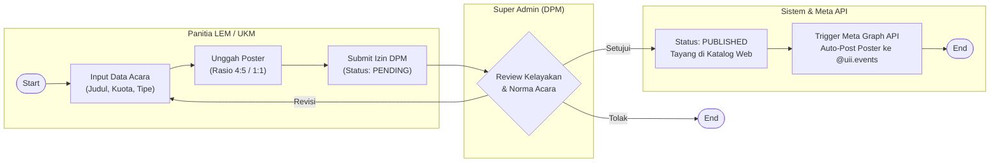
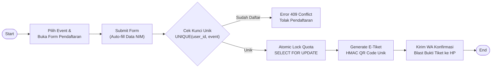
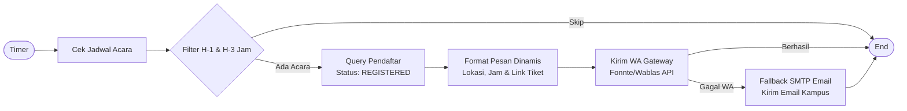
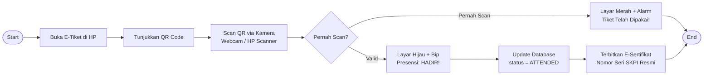
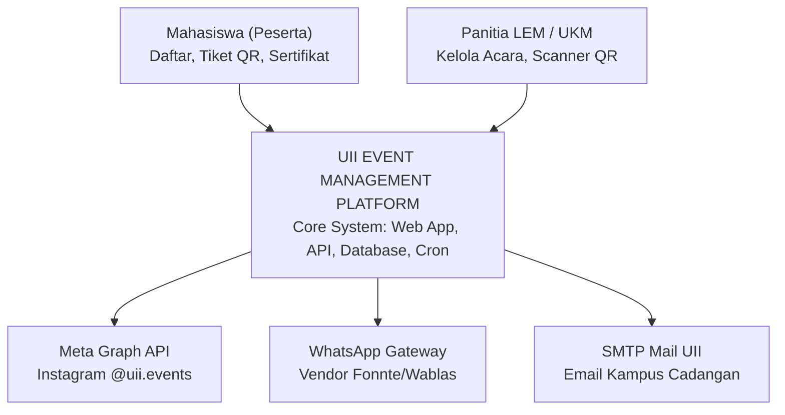

# Master Product Requirement Document (PRD) — UII Event Management Platform

> **Universitas Islam Indonesia (UII)** — Dewan Perwakilan Mahasiswa (DPM) • Lembaga Eksekutif Mahasiswa (LEM)
> Enterprise Software Architecture & Product Blueprint
> Sistem Informasi Manajemen Kegiatan Mahasiswa Terpadu

**Visi Strategis Produk:** Membangun platform terpadu satu pintu (*Single Source of Truth*) yang mentransformasi ekosistem kegiatan di UII dari pola manual yang tersebar menjadi otomatis, transparan, dan terukur. Sistem menyelesaikan 4 problem utama kampus: Pendaftaran Manual, Double Entry, Poster Liar Tak Terpusat, dan Ketidakhadiran Peserta akibat ketiadaan pengingat — melalui presensi QR Code, otomasi pengingat via WhatsApp Gateway & Email, serta publikasi otomatis ke Instagram Resmi Kampus.

## Identifikasi Dokumen

| Atribut | Nilai |
|---|---|
| Nomor Dokumen | DOC-PRD-UII-EVT-2026-V1.0 (Master Release) |
| Tanggal Efektif | 17 November 2026 |
| Penanggung Jawab Produk | Lead System Analyst (SA) |
| Status Kelayakan | APPROVED FOR IMPLEMENTATION |
| Klasifikasi | Confidential / Internal Engineering Blueprint |
| Target Tim Pelaksana | UI/UX Designer, Backend, Frontend, QA Engineer |
| Standar Rekayasa | IEEE 830 / ISO/IEC/IEEE 29148 |

## Riwayat Revisi Dokumen

| Versi | Tanggal | Penyusun / Peran | Deskripsi Perubahan & Catatan Teknis |
|---|---|---|---|
| v0.1 | 10 Nov 2026 | System Analyst Team | Draf awal dekomposisi masalah studi kasus kegiatan kampus dan identifikasi aktor sistem. |
| v0.5 | 14 Nov 2026 | System Analyst Team | Penambahan analisis alur 2 mode (Peserta vs Oprec), eliminasi modul LPJ keuangan dari scope. |
| v1.0 | 17 Nov 2026 | Lead System Analyst | Master Release: integrasi 4 diagram BPMN 2.0 (.bpmn), spesifikasi WhatsApp Gateway, Meta Graph API Instagram, kriteria penerimaan Gherkin, dan matriks NFR. |

## Matriks Otorisasi & Persetujuan (Sign-off)

| Peran Stakeholder | Nama Lengkap | Departemen / Institusi | Status |
|---|---|---|---|
| Lead System Analyst | Fadhil Muhammad, S.Kom. | Engineering & Product Lead | APPROVED (17/11/2026) |
| Perwakilan Organisasi | Sarah Nabila | Ketua LEM FTI UII | APPROVED (17/11/2026) |
| Dewan Perwakilan Mahasiswa | Dr. Ir. Budi Hartono, M.T. | DPM Universitas Islam Indonesia | APPROVED (17/11/2026) |

## Daftar Isi

1. [Visi Produk & Strategic Business Context](#bab-1-visi-produk--strategic-business-context)
2. [Analisis Pengguna & Pemetaan Stakeholder](#bab-2-analisis-pengguna--pemetaan-stakeholder)
3. [Ruang Lingkup Sistem & Batasan Produk](#bab-3-ruang-lingkup-sistem--batasan-produk)
4. [Pemodelan Proses Bisnis BPMN 2.0](#bab-4-pemodelan-proses-bisnis-bpmn-20-terperinci)
5. [Dekomposisi Fitur & Kebutuhan Fungsional](#bab-5-dekomposisi-fitur--epics-spesifikasi-fungsional)
6. [Kebutuhan Non-Fungsional (NFR)](#bab-6-spesifikasi-kebutuhan-non-fungsional-nfr-terukur)
7. [Arsitektur Sistem & Integrasi Pihak Ketiga](#bab-7-arsitektur-sistem--integrasi-pihak-ketiga)
8. [User Stories & Kriteria Penerimaan (Gherkin)](#bab-8-user-stories--kriteria-penerimaan-format-gherkin)
9. [Manajemen Risiko & Rencana Mitigasi](#bab-9-manajemen-risiko--rencana-mitigasi)
10. [Rencana Pelaksanaan & Kesiapan Rilis](#bab-10-rencana-pelaksanaan--kesiapan-rilis-release-plan)

---

## BAB 1: Visi Produk & Strategic Business Context

### 1.1 Latar Belakang Institusional & Kondisi Kampus UII

UII sebagai institusi pendidikan tinggi terkemuka di Yogyakarta menaungi puluhan ribu mahasiswa di berbagai fakultas (FTI, FE, FH, FIAI, FPSB, FMIPA, FK, FTSP). Kehidupan organisasi kemahasiswaan dinaungi oleh Lembaga Eksekutif Mahasiswa (LEM), Dewan Perwakilan Mahasiswa (DPM), serta beragam Unit Kegiatan Mahasiswa (UKM) yang aktif memproduksi kegiatan berskala lokal, nasional, hingga internasional.

Kegiatan-kegiatan ini penting bukan hanya untuk pembentukan *soft skills* kepemimpinan, tetapi juga menjadi syarat administratif akademik melalui poin **Surat Keterangan Pendamping Ijazah (SKPI)** yang diwajibkan bagi setiap wisudawan. Sayangnya, infrastruktur pendukung pengelolaan kegiatan saat ini masih analog, tercerai-berai, dan tidak memiliki standarisasi terpusat.

### 1.2 Analisis Akar Masalah (Root Cause & Fishbone Decomposition)

Melalui wawancara terstruktur dengan pengurus ormawa dan mahasiswa pendaftar, diidentifikasi 4 problem inti:

| Area Masalah | Gejala Lapangan | Akar Masalah | Dampak Kegagalan Sistem |
|---|---|---|---|
| **1. Pendaftaran Manual & Sporadis** | Tiap ormawa membuat Google Form sendiri dengan format input berbeda; mahasiswa mengetik ulang nama dan NIM berulang kali. | Tidak ada sistem identitas tunggal (*Single Identity Provider*) yang menghubungkan data pendaftaran dengan master data mahasiswa. | Beban input tinggi bagi pendaftar; rekapitulasi data panitia lambat dan rawan *human error* saat dipindah ke Excel. |
| **2. Insiden Double Entry Data** | Nama mahasiswa yang sama muncul 2–4 kali di rekap panitia dengan nomor registrasi berbeda. | Google Form tidak punya validasi relasional unik (*Unique Constraint*) real-time lintas submisi. | Kuota gedung terisi fiktif (*false capacity depletion*); mahasiswa yang benar-benar berminat tidak kebagian kursi. |
| **3. Poster & Informasi Liar Tersebar** | Mahasiswa tidak tahu ada seminar besar di fakultas sebelah; poster hanya tersebar di story Instagram pribadi pengurus. | Tidak ada portal repositori informasi resmi kampus; kurasi izin kegiatan tidak terhubung dengan saluran media sosial resmi. | Jangkauan audiens sempit; citra profesionalisme kampus menurun akibat poster beredar tanpa verifikasi izin resmi. |
| **4. Tingginya Angka Ketidakhadiran (No-Show)** | Ketidakhadiran 35–45% pada acara gratis; aula kosong saat acara dimulai. | Panitia tidak punya otomatisasi pengingat; mahasiswa lupa jadwal yang didaftarkan berminggu-minggu sebelumnya. | Pemborosan biaya konsumsi, seminar kit terbuang, pembicara tamu kecewa melihat aula sepi. |

> **Visi Produk Terpadu:** "Mewujudkan UII Event Management Platform sebagai pusat gravitasi informasi dan operasional seluruh kegiatan kemahasiswaan UII yang menghilangkan friksi pendaftaran melalui otomasi cerdas, mengamankan data kepesertaan, serta memberikan dampak nyata pada peningkatan partisipasi aktif mahasiswa di kampus."

### 1.3 Baseline Metrik Eksisting vs Target Objektif (OKRs)

| Objective Strategis | Key Result (Indikator Kuantitatif) | Baseline Saat Ini | Target Pasca Rilis |
|---|---|---|---|
| **Objektif 1:** Menjamin Integritas & Keadilan Pendaftaran Peserta | Tingkat kesalahan data ganda (*Double Entry Rate*) | 18.4% dari total formulir | 0.0% (Zero Error) |
| | Waktu mahasiswa untuk submit pendaftaran | 3–5 menit | < 30 detik (auto-fill NIM) |
| **Objektif 2:** Memaksimalkan Partisipasi & Kehadiran Nyata | Rasio kehadiran peserta (*Attendance Rate*) | 58.2% | ≥ 85.0% (didorong WA H-1) |
| | Tingkat pembacaan pesan pengingat (*Open Rate*) | 12.5% (email blasting) | ≥ 94.0% (WhatsApp Gateway) |
| **Objektif 3:** Efisiensi Operasional Panitia di Meja Registrasi | Kecepatan presensi per peserta | 45–60 detik/orang | ≤ 3 detik/orang (QR Scanner) |
| | Waktu tunggu penerbitan & distribusi e-sertifikat | 14–21 hari kerja | Instan (detik itu juga) |
| **Objektif 4:** Peningkatan Visibilitas Promosi Kampus | Waktu tunggu posting poster ke Instagram @uii.events | 1–2 hari kerja | < 30 detik (Auto Meta API) |

### 1.4 Pilar Nilai Inti Produk (Product Core Values)

1. **Zero-Friction Registration** — Pendaftaran tidak boleh membebani mahasiswa dengan pertanyaan repetitif. Sistem menarik data identitas dari direktori kampus.
2. **Anti-Tamper & High Integrity** — Tiket digital dan sertifikat diproteksi tanda tangan kriptografi (HMAC-SHA256) untuk mencegah tiket palsu dan pemalsuan dokumen SKPI.
3. **Omnichannel Engagement** — Menjangkau mahasiswa di saluran harian mereka (WhatsApp dan Instagram) daripada membiarkan informasi tenggelam di email.
4. **Extreme Reliability on Event Day** — Meja registrasi hari-H harus tetap beroperasi dalam kondisi internet kampus padat melalui arsitektur *offline-first camera caching*.

---

## BAB 2: Analisis Pengguna & Pemetaan Stakeholder

### 2.1 Matriks Stakeholder RACI

| Aktivitas / Modul Sistem | Mahasiswa | Panitia LEM/UKM | DPM Kemahasiswaan | Tim Pengembang |
|---|---|---|---|---|
| Perumusan Draf Acara & Penentuan Kuota | I | R | A | C |
| Kurasi Legalitas & Approval Izin Acara | I | C | A & R (Approver) | I |
| Pendaftaran Kegiatan & Pengisian Formulir | R | I | I | A (Platform Lock) |
| Operasional Scan Presensi Hari-H | C (Tunjuk QR) | R (Operator Scan) | I | A (Platform Uptime) |
| Validasi & Verifikasi Sertifikat SKPI | I (Download) | C (Penyelenggara) | A (Regulator SKPI) | R (Generate Hash) |

*R = Responsible, A = Accountable, C = Consulted, I = Informed.*

### 2.2 Profil Persona Pengguna

**Persona 1 — Muhammad Rian (Mahasiswa Informatika UII, Peserta Aktif)**

| Aspek | Deskripsi |
|---|---|
| Demografi & Kebiasaan | Laki-laki, 21 tahun, mahasiswa Semester 5 FTI UII. Pengguna aktif Android (Xiaomi/Samsung). Menghabiskan 4–6 jam/hari di WhatsApp dan Instagram; membuka email kampus maksimal 1×/minggu saat masa KRS. |
| Kebutuhan Emosional | Aman bahwa namanya tercatat saat mendaftar; ingin kepastian tiket tidak hilang walau riwayat chat WA terhapus; butuh bukti sertifikat resmi untuk klaim poin SKPI di semester akhir. |
| Frustrasi Utama | Pernah ditolak panitia di meja registrasi karena lupa screenshot bukti form; sering ketinggalan workshop gratis yang kuotanya habis dalam 10 menit tanpa notifikasi. |

**Persona 2 — Sarah Nabila (Ketua Divisi Acara LEM FTI UII, Organizer)**

| Aspek | Deskripsi |
|---|---|
| Demografi & Kebiasaan | Perempuan, 22 tahun, mahasiswi Semester 7. Memimpin tim kepanitiaan 25 orang. Bekerja dengan laptop MacBook/Windows saat rapat koordinasi. Bertanggung jawab atas ketercapaian kuota 300 peserta seminar tahunan. |
| Kebutuhan Emosional | Ketenangan pikiran saat hari-H; tidak ingin disalahkan dosen pendamping jika acara molor akibat antrean registrasi; ingin kemudahan merekrut staf panitia (Oprec) tanpa memilah ratusan link Google Drive berkas CV. |
| Frustrasi Utama | Begadang membersihkan baris ganda di Excel; panitia registrasi bingung saat ada 2 nama mirip di daftar cetak; kerepotan membalas chat WA ratusan peserta yang menanyakan sertifikat pasca acara. |

### 2.3 Peta Perjalanan Pengguna (User Journey Mapping)

| Fase | Tindakan Pengguna | Touchpoints Sistem | Kondisi Emosional & Peluang Solusi |
|---|---|---|---|
| **1. Discovery** | Melihat poster di Instagram resmi @uii.events atau membuka katalog web UII Event. | Feed Instagram terintegrasi API, search bar, filter chip kategori. | *Tertarik* — info tanggal, pembicara, dan sisa kuota langsung terbaca jelas tanpa tanya admin. |
| **2. Registration** | Klik daftar, verifikasi data profil NIM otomatis, pilih atribut khusus, konfirmasi. | Form pendaftaran cerdas, validasi composite unique constraint, kuota lock. | *Lega & percaya* — tidak perlu ketik ulang data; kepastian instan tiket didapat. |
| **3. Anticipation** | Menjalani rutinitas kuliah menunggu jadwal acara (3–14 hari). | Cron Scheduler, WhatsApp Gateway API H-1 (09.00) dan H-3 jam. | *Tenang* — mahasiswa tidak lupa; pesan WA berisi panduan rute gedung dan link tiket cepat. |
| **4. Day-of-Event** | Tiba di lobi, membuka layar ponsel, menunjukkan QR Code tiket. | E-Tiket Digital (SCR-MHS-02), Web Scanner Kamera Panitia (SCR-PAN-05). | *Puas & cepat* — presensi selesai dalam 2 detik dengan bip; antrean lobi lancar. |
| **5. Post-Event** | Membuka riwayat di ponsel untuk mengunduh sertifikat resmi. | Brankas Sertifikat (SCR-MHS-03), Verifier Hash Publik SKPI. | *Bangga* — sertifikat tersimpan aman; nomor seri resmi diakui bagian akademik. |

**Prinsip Desain Pengalaman Pengguna (UX Guiding Principles):**

- **Predictable Outcomes** — Setiap tindakan pengguna (submit, pembatalan, scan QR) harus memberi konfirmasi visual dan audio yang tegas tanpa ambiguitas status.
- **Thumb-Zone Ergonomics** — 90%+ pendaftar mengakses dari ponsel, sehingga semua CTA penting wajib berada di area bawah layar (*bottom sheet / sticky footer*) yang mudah dijangkau satu tangan.

---

## BAB 3: Ruang Lingkup Sistem & Batasan Produk

### 3.1 Ruang Lingkup Fungsional (In-Scope)

Fase 1 (MVP) mencakup 6 kelompok kapabilitas utama yang terintegrasi penuh *(dokumen asli menyebut "6", namun mendaftar 7 butir)*:

1. **Katalog Terpusat & Mesin Kurasi Acara** — Manajemen siklus draf kegiatan oleh ormawa, verifikasi berjenjang oleh DPM, pencarian publik terfilter.
2. **Pendaftaran Cerdas 2 Jalur (Dual-Track Registration)** — Pendaftaran peserta acara umum (seminar, workshop, konser) dan seleksi rekrutmen panitia (Oprec) dalam satu sistem.
3. **Proteksi Integritas Data & Concurrency Guard** — Pencegahan absolut data pendaftar ganda (*anti-double entry*) dan perlindungan kuota gedung via penguncian transaksional database.
4. **Otomasi Pengingat Omnichannel** — Pengingat berbasis waktu (H-1 dan H-3 jam) memadukan WhatsApp Gateway API dan email SMTP kampus.
5. **Auto-Post ke Akun Instagram Resmi** — Integrasi Meta Graph API untuk publikasi poster dan caption ke @uii.events begitu disetujui admin.
6. **Tiketing Dinamis & Presensi Meja Registrasi** — E-Tiket QR Code terenkripsi + Web Scanner kamera dengan validasi instan anti-tiket duplikat.
7. **Brankas E-Sertifikat Digital (SKPI-Ready)** — Pembukaan otomatis hak unduh sertifikat bernomor seri bagi peserta yang tervalidasi hadir.

### 3.2 Fitur Dikeluarkan dari Ruang Lingkup (Out-of-Scope)

| Fitur yang Dieliminasi | Alasan | Rencana / Alternatif |
|---|---|---|
| Modul Pelaporan Keuangan LPJ Mendalam | LPJ menyangkut aturan akuntansi universitas yang kompleks (nota, perpajakan, audit kas DPM) dan mengaburkan fokus pendaftaran acara. | Dikeluarkan ke Fase 3. Saat ini hanya ekspor rekap demografi & presensi ke Excel untuk dilampirkan ke LPJ fisik. |
| Integrasi Payment Gateway Perbankan (Midtrans/Xendit) | Mayoritas kegiatan gratis. Payment gateway butuh perizinan rekening penampung yayasan (Badan Wakaf UII) dan biaya admin per transaksi. | Fase 1 fokus acara gratis (90% acara kampus). Seminar berbayar: panitia menyematkan instruksi transfer manual dan konfirmasi tiket manual. |
| Live Chat Real-Time Panitia–Peserta | Butuh infrastruktur WebSocket berbiaya tinggi dan beban moderasi berat. | Diganti tautan langsung ke *WhatsApp Helpdesk Panitia* di halaman detail acara. |

### 3.3 Asumsi, Ketergantungan, & Batasan Proyek

- **Asumsi:** Mahasiswa memiliki smartphone berkamera dan nomor WhatsApp aktif yang terdaftar di sistem.
- **Ketergantungan Eksternal:** Meta Graph API (Instagram Publishing) dan vendor WhatsApp Gateway API (Fonnte/Wablas) dengan uptime ≥ 99%.
- **Batasan Teknis:** Dioptimalkan untuk peramban modern (Chrome, Firefox, Safari, Edge) tanpa aplikasi native dari Play Store / App Store.

---

## BAB 4: Pemodelan Proses Bisnis BPMN 2.0 Terperinci

Representasi dari berkas BPMN 2.0 XML di repositori proyek: `D:\AntigravityProjects\uii-event-management\bpmn\`.

### 4.1 Sub-Proses 1: Pengajuan Draf, Kurasi Admin, & Auto-Post Instagram

**Berkas sumber:** `bpmn_01_event_lifecycle_autopost.bpmn` — interaksi antara ormawa penyelenggara, kurator DPM, dan Meta Instagram API.



**Penjelasan:** Proses diawali pembuatan draf oleh ormawa. Draf yang diajukan masuk antrean *review* Super Admin. Jika DPM menyetujui, event berubah status menjadi `PUBLISHED`. Dalam transaksi yang sama, sistem mendaftarkan tugas ke *background worker* untuk memanggil Meta Graph API (`POST /{ig_user_id}/media` dan `POST /{ig_user_id}/media_publish`) untuk mengunggah dan mempublikasikan poster ke akun Instagram resmi kampus.

### 4.2 Sub-Proses 2: Pendaftaran Peserta & Kunci Anti-Double Entry

**Berkas sumber:** `bpmn_02_registration_anti_double_entry.bpmn` — pencegahan data pendaftaran ganda dan perlindungan sisa kuota secara transaksional di level database.



**Penjelasan:** Titik kritis adalah pencegahan *race condition*. Sistem mengecek keunikan pasangan `(user_id, event_id)`. Jika duplikat, langsung respons `409 Conflict`. Jika unik, transaksi mengunci baris kuota dengan `SELECT FOR UPDATE` untuk mencegah overbooking saat ratusan mahasiswa submit bersamaan di detik terakhir. Setelah kuota aman dikurangi, e-tiket di-hash dan pesan WhatsApp konfirmasi dikirim.

### 4.3 Sub-Proses 3: Mesin Pengingat Otomatis (Omnichannel Scheduler)

**Berkas sumber:** `bpmn_03_automated_reminder_engine.bpmn` — siklus kerja *Background Cron Worker* memicu pengingat WhatsApp dengan cadangan email.



**Penjelasan:** Scheduler dieksekusi setiap jam secara asinkron. Sistem membaca peserta yang belum menerima notifikasi H-1 atau H-3 jam. Jika pengiriman WhatsApp Gateway gagal (gangguan jaringan vendor atau limit kuota), sistem otomatis menjalankan *fallback* via server SMTP Email Kampus UII.

### 4.4 Sub-Proses 4: Presensi Masuk Hari-H & Penerbitan Sertifikat SKPI

**Berkas sumber:** `bpmn_04_day_h_attendance_certificate.bpmn` — interaksi berkecepatan tinggi di meja registrasi antara peserta, pemindai kamera, dan penerbitan sertifikat digital.



**Penjelasan:** Kamera scanner membaca QR Code dan mengirim hash signature ke server. Sistem mencocokkan hash dan mengecek atribut `is_checked_in`. Jika `TRUE`, sistem memicu status merah untuk mencegah 1 tiket dipakai 2 orang. Jika `FALSE`, status menjadi `ATTENDED` dan sistem otomatis membangkitkan record sertifikat resmi dengan hash verifikasi publik untuk SKPI.

---

## BAB 5: Dekomposisi Fitur & Epics (Spesifikasi Fungsional)

Seluruh kebutuhan fungsional dikelompokkan ke dalam 5 Epic yang memandu backlog pengembangan.

### 5.1 EPIC 1: Katalog Acara & Publikasi Medsos Terpadu

| Kode FR | Nama | Rincian Spesifikasi & Aturan Bisnis | Prioritas |
|---|---|---|---|
| FR-EVT-01 | Pencarian & Filter Acara | Pencarian teks bebas (judul, pembicara) dan filter multikategori (Seminar, Workshop, Lomba, Konser, Oprec) dengan pembaruan dinamis tanpa reload halaman. | P0 (MUST) |
| FR-EVT-02 | Indikator Kuota Real-Time | Halaman detail menampilkan sisa kuota akurat. Jika kuota 0, tombol pendaftaran otomatis berubah menjadi "Masuk Waiting List". | P0 (MUST) |
| FR-EVT-03 | Auto-Post Instagram Graph API | Saat Super Admin klik "Approve & Publish", sistem mengunggah poster dan caption resmi ke @uii.events via Meta Content Publishing API. | P2 (COULD) |

### 5.2 EPIC 2: Pendaftaran Adaptif (Peserta Acara vs Oprec Panitia)

| Kode FR | Nama | Rincian Spesifikasi & Aturan Bisnis | Prioritas |
|---|---|---|---|
| FR-REG-01 | Auto-Fill Profil Mahasiswa | Form otomatis mengisi NIM, Nama Lengkap, Program Studi, dan Fakultas dari sesi akun terautentikasi. | P0 (MUST) |
| FR-REG-02 | Integritas Anti-Double Entry | Menolak pendaftaran jika kombinasi `(user_id, event_id)` sudah memiliki record berstatus aktif; mengembalikan HTTP 409 Conflict. | P0 (MUST) |
| FR-REG-03 | Form Dinamis Oprec Panitia | Khusus `COMMITTEE_RECRUITMENT`: opsi Divisi (Pilihan 1 & 2), input motivasi, validasi unggah CV/KRS (PDF, maks 5MB). | P1 (SHOULD) |

### 5.3 EPIC 3: Otomasi Omnichannel WhatsApp & Email

| Kode FR | Nama | Rincian Spesifikasi & Aturan Bisnis | Prioritas |
|---|---|---|---|
| FR-NOT-01 | Pemicu Pengingat Otomatis H-1 | Scheduler mendeteksi acara H-1 pada pukul 09.00 WIB dan mengirim WhatsApp ke seluruh peserta terdaftar berisi waktu, gedung/link meeting, dan link tiket QR. | P1 (SHOULD) |
| FR-NOT-02 | Pengingat Kilat H-3 Jam | Pesan singkat 3 jam sebelum acara untuk mengingatkan pembukaan meja registrasi ulang. | P1 (SHOULD) |
| FR-NOT-03 | Fallback Kanal Email SMTP | Jika WhatsApp Gateway mengembalikan error atau batas kuota habis, sistem otomatis beralih ke email resmi kampus mahasiswa. | P1 (SHOULD) |

### 5.4 EPIC 4: Tiketing Dinamis & Presensi Meja Registrasi

| Kode FR | Nama | Rincian Spesifikasi & Aturan Bisnis | Prioritas |
|---|---|---|---|
| FR-TCK-01 | Generasi QR Code Dinamis | String QR dienkripsi HMAC-SHA256 dengan timestamp terikat untuk mencegah pemalsuan via screenshot. | P0 (MUST) |
| FR-TCK-02 | Web Scanner Meja Registrasi | Antarmuka pemindai kamera (HTML5 WebCam) yang diakses panitia via browser laptop/tablet tanpa instal aplikasi. | P0 (MUST) |
| FR-TCK-03 | Pencegahan Tiket Digunakan Berulang | Jika QR yang sama dipindai kedua kali, scanner menampilkan layar MERAH, suara peringatan, dan waktu scan pertama. | P0 (MUST) |
| FR-TCK-04 | Pembatalan Tiket Mandiri | Mahasiswa dapat membatalkan maksimal H-1 lewat menu Event Saya; otomatis mengembalikan +1 kuota. | P2 (COULD) |

### 5.5 EPIC 5: Brankas E-Sertifikat Digital (SKPI-Ready)

| Kode FR | Nama | Rincian Spesifikasi & Aturan Bisnis | Prioritas |
|---|---|---|---|
| FR-CRT-01 | Penerbitan Sertifikat Bersyarat Kehadiran | Hak unduh sertifikat PDF kualitas cetak **hanya aktif** jika pendaftaran berstatus `ATTENDED` (terverifikasi saat scan tiket). | P1 (SHOULD) |
| FR-CRT-02 | Nomor Seri & Verifikasi Keaslian Publik | Setiap sertifikat memuat nomor seri unik universitas dan QR link verifikasi publik (contoh: `uii-event.id/verify/{hash}`) untuk klaim SKPI. | P1 (SHOULD) |
| FR-CRT-03 | Arsip Portofolio Kemahasiswaan Permanen | Seluruh riwayat kegiatan dan sertifikat tersimpan permanen di akun mahasiswa dan dapat diunduh kapan saja tanpa kedaluwarsa. | P1 (SHOULD) |

> **Prinsip Ketelusuran Kebutuhan:** Setiap kode FR (FR-EVT, FR-REG, FR-NOT, FR-TCK, FR-CRT) terhubung langsung dengan skenario pengujian di Bab 8 dan matriks ketelusuran di Bab 10, memastikan tidak ada kebutuhan bisnis yang tertinggal saat verifikasi akhir oleh QA.

---

## BAB 6: Spesifikasi Kebutuhan Non-Fungsional (NFR) Terukur

### 6.1 Performa & Skalabilitas

| Parameter | Target Kriteria Terukur | Metodologi Pengujian |
|---|---|---|
| Waktu Muat Halaman Katalog (FCP) | First Contentful Paint < 1.2 detik pada jaringan 4G standar | Google Lighthouse Mobile & WebPageTest |
| Latensi API Pendaftaran (P95) | Response time < 300 ms saat melayani transaksi pendaftaran | Uji beban k6 / Apache JMeter dengan 250 transaksi konkuren |
| Throughput Web Scanner Presensi | Waktu proses kamera hingga bip < 1.5 detik per tiket | Simulasi pemindaian 100 QR Code berturut-turut di meja registrasi |
| Kapasitas Beban Puncak (Concurrency) | Menampung 500 pengguna aktif bersamaan tanpa error 500 | Stress testing database connection pooling & Redis caching |

### 6.2 Keamanan Informasi & Kepatuhan Data

| Aspek | Spesifikasi Teknis | Standar Acuan |
|---|---|---|
| Otentikasi & Otorisasi | JWT berbasis HS256, kedaluwarsa 2 jam; Refresh Token di HttpOnly Cookie | RFC 7519 & RBAC Middleware |
| Pencegahan Celah Web | Sanitasi input (anti-XSS); Parameterized Query / ORM (anti-SQLi); proteksi CSRF Token | OWASP Top 10 (2025/2026) |
| Enkripsi Payload QR Tiket | String QR dienkripsi kunci rahasia HMAC-SHA256 sehingga tidak bisa dimanipulasi dengan generator barcode gratisan | NIST FIPS 198-1 |
| Perlindungan Data Pribadi (PDP) | Nomor WhatsApp dan email hanya dapat diakses panitia acara terkait; tidak diekspos ke katalog publik | UU No. 27 Tahun 2022 tentang PDP |

### 6.3 Keandalan & Toleransi Bencana

- **Uptime SLA:** minimal 99.5% selama jam aktif kampus (07.00–21.00 WIB).
- **Backup Database:** otomatis setiap hari pukul 02.00 WIB, retensi 30 hari.
- **Offline Scanner Fallback:** jika Wi-Fi gedung terputus, web scanner tetap memindai dengan memvalidasi tanda tangan QR lokal di IndexedDB peramban dan sinkronisasi otomatis saat internet kembali.

---

## BAB 7: Arsitektur Sistem & Integrasi Pihak Ketiga

### 7.1 Arsitektur Tingkat Tinggi (C4 Model Context Diagram)



### 7.2 Alur Integrasi Pihak Ketiga

**A. Meta Instagram Graph API (Content Publishing)** — alur dua tahap resmi:

1. **Inisiasi Container Media:** HTTP POST ke `https://graph.facebook.com/v19.0/{ig_user_id}/media` dengan URL gambar poster publik dan caption berformat lengkap dengan tagar kampus. Meta mengembalikan ID Container sementara.
2. **Eksekusi Publikasi:** Setelah jeda verifikasi 5 detik, sistem memicu publikasi lewat `POST /{ig_user_id}/media_publish?creation_id={container_id}`. ID unggahan disimpan di database untuk audit.

**B. WhatsApp Gateway API (Fonnte / Wablas)** — pengiriman asinkron via REST API:

- Payload berisi nomor tujuan format internasional (diawali `628...`), teks pesan markdown (tebal, miring), dan tautan pendek ke E-Tiket mahasiswa.
- Sistem memantau *delivery status*. Jika `FAILED` (misal nomor tidak terdaftar WA), sistem otomatis mengaktifkan antrean email via SMTP kampus.

### 7.3 Diagram Alir Data (DFD Level 1) — Sistem Inti UII Event

| No. | Proses Bisnis | Data Masukan | Data Keluaran & Data Store |
|---|---|---|---|
| 1.0 | Otentikasi & Manajemen Pengguna | Kredensial NIM/Email & Password akun UII | Sesi Token JWT → D1: `users` & D2: `roles` |
| 2.0 | Manajemen Draf & Kurasi Acara | Formulir acara, berkas poster, izin ormawa, approval DPM | Record Acara → D3: `events`; pemicu Meta API |
| 3.0 | Transaksi Pendaftaran & Kuota | ID Event, ID Mahasiswa, atribut pilihan formulir | Record Tiket → D4: `registrations` & D5: `tickets` |
| 4.0 | Mesin Pengingat Terjadwal | Data registrasi aktif & jadwal waktu mulai kegiatan | Payload Pesan WA/Email → D6: `notification_logs` |
| 5.0 | Validasi Presensi Meja Registrasi | String barcode QR hasil pembacaan kamera | Update status `ATTENDED` & penerbitan ke D7: `certificates` |

### 7.4 Skema Relasi Konseptual Basis Data (3NF)

| Entitas Tabel | Kunci Utama & Relasi Asing | Aturan Validasi & Indeks Khusus |
|---|---|---|
| `users` | PK: `id` | `UNIQUE(nim)`, `UNIQUE(email)`. Mengisolasi akun mahasiswa & admin. |
| `events` | PK: `id`, FK: `organizer_id`, `category_id` | `quota_remaining ≤ quota_total`. Status enum terkendali. |
| `registrations` | PK: `id`, FK: `user_id`, `event_id` | Composite Unique Index `UNIQUE(user_id, event_id)` (Anti-Double Entry Guard). |
| `tickets` | PK: `id`, FK: `registration_id` (1-to-1) | `UNIQUE(ticket_code)`, `UNIQUE(qr_payload)`, Boolean `is_checked_in`. |
| `certificates` | PK: `id`, FK: `registration_id` (1-to-1) | `UNIQUE(certificate_number)`, hash keaslian SHA-256 untuk SKPI. |

---

## BAB 8: User Stories & Kriteria Penerimaan (Format Gherkin)

### US-01: Validasi Pencegahan Pendaftaran Ganda (Anti-Double Entry) — KRITIS (P0)

> **Sebagai** Mahasiswa UII, **saya ingin** sistem menolak jika saya tidak sengaja mendaftar ulang pada acara yang sama, **agar** kuota tidak terpakai ganda dan tiket saya tidak rancu.

**Scenario 1: Mahasiswa mendaftar ulang pada acara yang sama**

```gherkin
Given Mahasiswa "Rian" (NIM: 21523001) telah memiliki tiket aktif di acara "Seminar AI 2026"
When  Rian membuka kembali halaman pendaftaran acara tersebut dan mengklik "Konfirmasi Pendaftaran"
Then  Sistem menolak permintaan pendaftaran dengan status HTTP 409 Conflict
And   Sistem menampilkan notifikasi merah: "Anda sudah terdaftar di acara ini"
And   Tombol pendaftaran dikunci dan diarahkan ke tautan "Lihat E-Tiket Saya"
```

### US-02: Pemindaian Tiket Cepat & Pencegahan Tiket Dipakai Berulang — KRITIS (P0)

> **Sebagai** Panitia Meja Registrasi, **saya ingin** scanner kamera mendeteksi tiket yang sudah pernah dipakai, **agar** tidak ada penyusup masuk dengan tangkapan layar tiket orang lain.

**Scenario 2.1: Scan tiket valid pertama kali**

```gherkin
Given Peserta A menunjukkan QR Code tiket yang sah dan belum pernah hadir (is_checked_in = FALSE)
When  Panitia mengarahkan kamera scanner ke QR Code peserta A
Then  Layar scanner mengeluarkan indikator kartu HIJAU dan bunyi bip sukses
And   Database memperbarui atribut is_checked_in menjadi TRUE dan mencatat waktu presensi
```

**Scenario 2.2: Scan tiket yang sama untuk kedua kalinya**

```gherkin
Given Tiket Peserta A sudah tervalidasi hadir 10 menit yang lalu
When  Tiket Peserta A dipindai kembali di meja registrasi kedua
Then  Layar scanner mengeluarkan kartu MERAH dan bunyi nada peringatan error
And   Sistem menampilkan teks: "Peringatan! Tiket sudah pernah di-scan pada pukul 08.15 WIB oleh Panitia 1"
```

### US-03: Eksekusi Pengingat Otomatis via WhatsApp Gateway — PENTING (P1)

> **Sebagai** Peserta Terdaftar, **saya ingin** menerima notifikasi WhatsApp pada H-1 acara, **agar** saya ingat jadwal dan lokasi gedung kegiatan.

**Scenario 3: Pengiriman pesan pengingat jadwal H-1**

```gherkin
Given Acara "Workshop UI/UX" dijadwalkan besok pukul 09.00 WIB
When  Scheduler server mendeteksi waktu hari ini tepat pukul 09.00 WIB
Then  Sistem memicu pengiriman pesan WhatsApp ke seluruh nomor peserta berstatus REGISTERED
And   Pesan mencantumkan Nama Peserta, Ruangan Gedung, Jam Registrasi Ulang, dan Link Membuka Tiket QR
And   Status pengiriman tercatat bernilai "SENT" di tabel notification_logs
```

---

## BAB 9: Manajemen Risiko & Rencana Mitigasi

### 9.1 Matriks Dampak & Probabilitas Risiko

| Potensi Kejadian Risiko | Probabilitas | Dampak | Skor | Rencana Mitigasi & Kontingensi Teknis |
|---|---|---|---|---|
| Lonjakan transaksi di kuota terakhir (*Race Condition*) | SEDANG | TINGGI | **TINGGI (CRITICAL)** | Row-Level Database Locking (`SELECT FOR UPDATE`) dalam satu transaksi atomik. Pendaftar yang kalah cepat dialihkan ke antrean Waiting List tanpa kuota bocor. |
| Vendor WhatsApp Gateway gangguan / kuota habis | SEDANG | SEDANG | SEDANG | *Fallback Architecture*: antrean pesan mendeteksi kegagalan API WA dan segera mengalihkan ke SMTP Email Kampus UII dalam < 60 detik. |
| Koneksi internet putus di meja registrasi hari-H | TINGGI | TINGGI | **TINGGI (CRITICAL)** | Web Scanner dilengkapi Service Worker & IndexedDB Offline Cache. Hasil scan divalidasi lokal dan disinkronkan otomatis saat internet kembali. |
| Penyalahgunaan akun organisasi untuk acara ilegal | RENDAH | TINGGI | SEDANG | Setiap acara berstatus draf non-publik dan **wajib** disetujui akun DPM UII sebelum terlihat mahasiswa umum. |

### 9.2 Kepatuhan Perlindungan Data & Etika Media Sosial Kampus

- **Minimized Data Collection:** Hanya menyimpan data dasar relevan (NIM, Nama, No. WhatsApp, Prodi). NIK dan data sensitif perbankan tidak pernah diminta.
- **Integritas Akun Instagram Kampus:** Kuota auto-post dibatasi maksimal 5 kali per jam untuk mencegah penalti spam algoritma Meta. Seluruh poster yang terunggah telah melewati persetujuan admin DPM.

---

## BAB 10: Rencana Pelaksanaan & Kesiapan Rilis (Release Plan)

### 10.1 Peta Jalan Pengembangan 3 Sprint

| Sprint | Fokus Utama | Deliverables per Disiplin | Milestone |
|---|---|---|---|
| **Sprint 1** (Hari 1–3) | Fondasi Data, Desain Antarmuka, & Arsitektur | **UI/UX:** finalisasi mockup 15 layar di Figma. **Backend:** DDL migrations & Auth JWT. **Frontend:** setup proyek & integrasi Mock API. **QA:** penyusunan Test Plan & Test Cases. | Cetak biru desain disepakati & skema database siap. |
| **Sprint 2** (Hari 4–7) | Pengembangan Fitur Inti (Core MVP) | **Frontend:** slicing katalog & form pendaftaran. **Backend:** endpoint pendaftaran, concurrency kuota, e-tiket. **UI/UX:** aset ilustrasi & feedback scanner. **QA:** eksekusi uji fungsional anti-double entry. | Alur pendaftaran dan terbit tiket QR berjalan sukses. |
| **Sprint 3** (Hari 8–10) | Integrasi Eksternal, Pengujian & Demo Magang | **Backend:** integrasi WA Gateway & Meta Graph API. **Frontend:** modul kamera Web Scanner. **QA:** stress testing kuota penuh & uji offline scanner. **SA (Lead):** panduan presentasi & dokumentasi final. | Aplikasi siap demo di hadapan penguji magang. |

### 10.2 Requirements Traceability Matrix (RTM Ringkas)

| Masalah Bisnis | Kode FR | Desain Layar | Tabel Database | Kode Skenario Uji QA |
|---|---|---|---|---|
| Pendaftaran Manual | FR-REG-01 | SCR-REG-01 | `registrations` | TC-REG-01 |
| Double Entry | FR-REG-02 | SCR-REG-01 | `registrations` (UQ) | TC-REG-02 |
| Poster Tersebar | FR-EVT-03 | SCR-PUB-01, SCR-ADM-01 | `events`, `notification_logs` | TC-SOC-01 |
| Ketiadaan Reminder | FR-NOT-01, 02 | SCR-MHS-01 | `notification_logs` | TC-REM-01 |
| Presensi Lambat | FR-TCK-02, 03 | SCR-PAN-05 (Scanner) | `tickets`, `certificates` | TC-SCN-01 |

### 10.3 Pernyataan Kesiapan Peluncuran (Go-Live Sign-Off)

**Otorisasi Implementasi Produk:** Dokumen Master PRD versi 1.0 ini secara resmi disahkan sebagai spesifikasi definitif. Seluruh rincian fungsional, diagram proses bisnis BPMN 2.0, standar arsitektur API, serta kriteria penerimaan di atas mengikat seluruh anggota tim pengembang UII Event Management Platform.

---
*© 2026 Badan Pengembangan Sistem Informasi Kemahasiswaan • Universitas Islam Indonesia*
