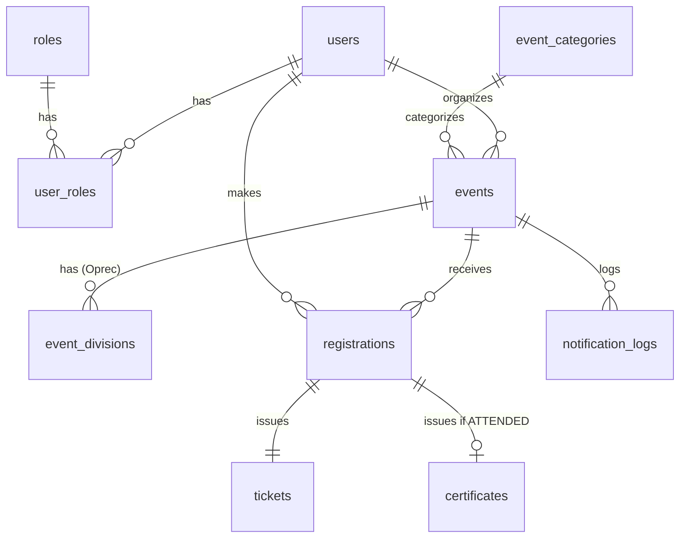

# Technical Design Document (TDD) — Arsitektur Basis Data (ERD) & Spesifikasi Kontrak REST API

> **Universitas Islam Indonesia (UII)** • Lembaga Eksekutif Mahasiswa
> UII Event Management Platform — Data & API Architecture

**Tujuan Dokumen:** Standar integrasi tunggal (*Single Source of Truth*) agar Backend Developer dapat menyusun migrasi database dan controller API, dan Frontend Developer dapat membuat *mock services* serta form integrasi secara paralel tanpa *schema mismatch*.

| Atribut | Nilai |
|---|---|
| Nomor Dokumen | DOC-TDD-UII-EVT-2026-V1.0 |
| Tanggal Terbit | 17 November 2026 |
| Penyusun | System Analyst (Lead SA) |
| Target Database | PostgreSQL 15+ / MySQL 8.0+ (Relational 3NF) |
| Target Arsitektur | RESTful API v1 (JSON Payload, JWT Auth) |
| Target Tim | Backend Developer, Frontend Developer, QA Engineer |

## Daftar Isi

1. [Arsitektur Basis Data (ERD) & Konsep Relasi](#bab-1-arsitektur-basis-data-erd--konsep-relasi)
2. [Kamus Data Lengkap](#bab-2-kamus-data-lengkap-data-dictionary)
3. [Standar & Konvensi REST API](#bab-3-standar--konvensi-rest-api)
4. [Spesifikasi Detail Kontrak REST API](#bab-4-spesifikasi-detail-kontrak-rest-api)
5. [Panduan Handover Teknis Tim Pengembang](#bab-5-panduan-handover-teknis-tim-pengembang)

---

## BAB 1: Arsitektur Basis Data (ERD) & Konsep Relasi

### 1.1 Desain Normalisasi & Integritas Relasi (3NF)

Arsitektur data dirancang memenuhi *Third Normal Form* (3NF) untuk menjamin tidak ada anomali penyisipan, pembaruan, maupun penghapusan. Database memisahkan tegas entitas identitas pengguna, kegiatan kampus, transaksi pendaftaran, penomoran e-tiket, serta riwayat notifikasi.

### 1.2 Diagram Relasi Antar Entitas



**Ringkasan keterhubungan tabel (Cardinality & FK Rules):**

- `roles (1) → (N) user_roles (N) ← (1) users` — Many-to-Many untuk peran multi-aktor (Mahasiswa, Panitia LEM, Super Admin).
- `event_categories (1) → (N) events` — Satu kategori menaungi banyak acara (Seminar, Workshop, Lomba, Konser, Oprec).
- `users (1) [Organizer] → (N) events` — Satu akun panitia ormawa dapat mengelola banyak acara.
- `events (1) → (N) event_divisions` — Khusus event tipe Oprec, satu acara punya banyak pilihan divisi.
- `users (1) → (N) registrations (N) ← (1) events` — Satu mahasiswa mendaftar ke acara dengan *Composite Unique Constraint* `UNIQUE(user_id, event_id)`.
- `registrations (1) → (1) tickets` — Satu pendaftaran peserta sah menerbitkan tepat satu e-tiket ber-QR Code.
- `registrations (1) → (0..1) certificates` — Sertifikat hanya diterbitkan jika pendaftaran berstatus `ATTENDED`.
- `events (1) → (N) notification_logs` — Satu event mencatat seluruh log pengiriman WhatsApp dan posting Instagram.

### 1.3 Kunci Integritas Anti-Double Entry (Database Level Guard)

Pencegahan pendaftaran berulang tidak boleh hanya mengandalkan pengecekan frontend/aplikasi backend karena rentan ditembus saat *concurrent request* (misal dua tab browser dibuka bersamaan). Integritas dikunci di level database:

```sql
-- Aturan Kritis Pencegahan Double Entry di Level Mesin Basis Data
CREATE UNIQUE INDEX uq_user_event_registration
ON registrations (user_id, event_id)
WHERE status != 'CANCELLED';
```

---

## BAB 2: Kamus Data Lengkap (Data Dictionary)

Spesifikasi struktur fisik tabel untuk penyusunan migrasi (Prisma, TypeORM, Laravel Migration, atau DDL mentah).

### Tabel 1: `users` — Akun Mahasiswa & Admin Kampus

| Kolom | Tipe | Constraint | Deskripsi & Contoh |
|---|---|---|---|
| `id` | UUID / BIGINT | PRIMARY KEY | Identifikator unik pengguna. |
| `nim` | VARCHAR(20) | UNIQUE, NULL | NIM UII (contoh `'21523001'`). Null untuk akun non-mahasiswa. |
| `name` | VARCHAR(100) | NOT NULL | Nama lengkap sesuai data universitas. |
| `email` | VARCHAR(100) | UNIQUE, NOT NULL | Email kampus resmi (contoh `'21523001@students.uii.ac.id'`). |
| `password` | VARCHAR(255) | NOT NULL | Hash password (Bcrypt/Argon2id). |
| `phone_number` | VARCHAR(20) | NOT NULL | Nomor WhatsApp aktif dengan kode negara (contoh `'6281234567890'`). |
| `faculty` | VARCHAR(80) | NULL | Fakultas (contoh `'Fakultas Teknologi Industri'`). |
| `study_program` | VARCHAR(80) | NULL | Program Studi (contoh `'Informatika'`). |
| `created_at` | TIMESTAMP | NOT NULL | Waktu pembuatan akun. Default `CURRENT_TIMESTAMP`. |

### Tabel 2: `roles` & `user_roles` — Manajemen Hak Akses RBAC

Enum: `STUDENT`, `ORGANIZER`, `SUPERADMIN`

| Kolom | Tipe | Constraint | Deskripsi |
|---|---|---|---|
| `id` | INT | PRIMARY KEY | ID Role (1: STUDENT, 2: ORGANIZER, 3: SUPERADMIN). |
| `name` | VARCHAR(30) | UNIQUE | Nama penanda role sistem. |
| `user_roles` | Pivot Table | FK(USER, ROLE) | Tabel penghubung Many-to-Many antara `users.id` dan `roles.id`. |

### Tabel 3: `events` — Master Data Kegiatan Mahasiswa

Status: `DRAFT`, `PENDING`, `PUBLISHED`, `REJECTED`, `COMPLETED`

| Kolom | Tipe | Constraint | Deskripsi & Aturan Bisnis |
|---|---|---|---|
| `id` | UUID / BIGINT | PRIMARY KEY | ID unik kegiatan. |
| `organizer_id` | UUID / BIGINT | FOREIGN KEY | Relasi ke `users.id` (akun LEM/UKM penyelenggara). |
| `category_id` | INT | FOREIGN KEY | Relasi ke `event_categories.id` (Seminar, Workshop, Lomba, Konser). |
| `title` | VARCHAR(150) | NOT NULL | Judul resmi acara. |
| `slug` | VARCHAR(180) | UNIQUE | URL-friendly identifier (contoh `'seminar-nasional-ai-2026'`). |
| `activity_type` | VARCHAR(30) | NOT NULL | Pembeda 2 jalur: `PARTICIPANT_EVENT` vs `COMMITTEE_RECRUITMENT`. |
| `poster_url` | VARCHAR(255) | NOT NULL | URL berkas poster di storage server / CDN. |
| `quota_total` | INT | NOT NULL | Kapasitas total kursi peserta. |
| `quota_remaining` | INT | NOT NULL | Sisa kuota terkini (dikurangi saat ada pendaftaran baru tervalidasi). |
| `start_time` | TIMESTAMP | NOT NULL | Waktu mulai acara (WIB). |
| `end_time` | TIMESTAMP | NOT NULL | Waktu selesai acara (WIB). |
| `location` | VARCHAR(150) | NOT NULL | Nama gedung & ruangan (offline) atau tautan meeting (online). |
| `status` | VARCHAR(30) | NOT NULL | `DRAFT`, `PENDING_APPROVAL`, `PUBLISHED`, `REJECTED`, `COMPLETED`. |
| `auto_post_ig` | BOOLEAN | DEFAULT TRUE | Apakah saat disetujui otomatis diposting ke Instagram resmi. |

### Tabel 4: `registrations` — Transaksi Pendaftaran Acara

Status: `REGISTERED`, `ATTENDED`, `CANCELLED`, `WAITING_LIST`

| Kolom | Tipe | Constraint | Deskripsi |
|---|---|---|---|
| `id` | UUID / BIGINT | PRIMARY KEY | ID pendaftaran unik. |
| `user_id` | UUID / BIGINT | FOREIGN KEY | Mahasiswa pendaftar (`users.id`). |
| `event_id` | UUID / BIGINT | FOREIGN KEY | Acara yang didaftari (`events.id`). |
| `registration_type` | VARCHAR(30) | NOT NULL | `PARTICIPANT` (Peserta) atau `COMMITTEE` (Oprec Panitia). |
| `custom_answers` | JSON / TEXT | NULL | Jawaban pertanyaan khusus (misal ukuran kaos `'XL'`). |
| `division_pref_1` | VARCHAR(50) | NULL | Pilihan Divisi 1 (khusus Oprec). |
| `division_pref_2` | VARCHAR(50) | NULL | Pilihan Divisi 2 (khusus Oprec). |
| `cv_file_url` | VARCHAR(255) | NULL | URL berkas CV/KRS yang diunggah pelamar. |
| `selection_status` | VARCHAR(30) | NULL | Khusus Oprec: `SUBMITTED`, `INTERVIEW_SCHEDULED`, `ACCEPTED`, `REJECTED`. |
| `status` | VARCHAR(30) | NOT NULL | Status kehadiran: `REGISTERED`, `ATTENDED`, `CANCELLED`. |
| `registered_at` | TIMESTAMP | NOT NULL | Waktu submit. Default `CURRENT_TIMESTAMP`. |

### Tabel 5: `tickets` — E-Tiket Digital & Data Scanner QR (1-to-1 dengan `registrations`)

| Kolom | Tipe | Constraint | Deskripsi |
|---|---|---|---|
| `id` | UUID / BIGINT | PRIMARY KEY | ID tiket. |
| `registration_id` | UUID / BIGINT | FK, UNIQUE | Relasi 1-ke-1 dengan `registrations.id`. |
| `ticket_code` | VARCHAR(50) | UNIQUE | Kode referensi publik (contoh `'TKT-2026-X7812'`). |
| `qr_payload` | VARCHAR(255) | UNIQUE | String hash terenkripsi untuk digenerate menjadi QR Code. |
| `is_checked_in` | BOOLEAN | DEFAULT FALSE | Apakah tiket sudah pernah di-scan pada hari-H. |
| `checked_in_at` | TIMESTAMP | NULL | Waktu presensi tercatat saat scan sukses. |
| `checked_in_by` | UUID / BIGINT | NULL | ID panitia yang scan (relasi ke `users.id`). |

### Tabel 6: `certificates` — Brankas E-Sertifikat Terverifikasi SKPI

Terbit otomatis saat `is_checked_in = TRUE`.

| Kolom | Tipe | Constraint | Deskripsi |
|---|---|---|---|
| `id` | UUID / BIGINT | PRIMARY KEY | ID sertifikat digital. |
| `registration_id` | UUID / BIGINT | FK, UNIQUE | Relasi ke pendaftaran peserta yang tervalidasi hadir. |
| `certificate_number` | VARCHAR(60) | UNIQUE | Nomor seri resmi kampus (contoh `'UII/DPM/CERT/2026/0491'`). |
| `verify_hash` | VARCHAR(64) | UNIQUE | Hash keaslian untuk verifikasi publik di `/verify/{hash}`. |
| `issued_at` | TIMESTAMP | NOT NULL | Waktu sertifikat diterbitkan. |

### Tabel 7: `notification_logs` — Audit Trail Pengiriman WA & IG

Tipe: `WA_REMINDER`, `WA_INTERVIEW`, `INSTAGRAM_AUTOPOST`

| Kolom | Tipe | Constraint | Deskripsi |
|---|---|---|---|
| `id` | BIGINT AUTO | PRIMARY KEY | ID log pengiriman. |
| `event_id` | UUID / BIGINT | FOREIGN KEY | Acara terkait. |
| `channel` | VARCHAR(20) | NOT NULL | `WHATSAPP`, `EMAIL`, `INSTAGRAM`. |
| `recipient` | VARCHAR(100) | NOT NULL | Nomor WA penerima / Email / Akun Instagram target. |
| `delivery_status` | VARCHAR(20) | NOT NULL | `SENT`, `FAILED`, `PENDING`. |
| `response_payload` | TEXT | NULL | Balasan JSON mentah dari vendor WA Gateway / Instagram API. |

---

## BAB 3: Standar & Konvensi REST API

### 3.1 Standar Format Respons Global (Response Envelope)

Seluruh endpoint wajib membungkus payload dalam struktur JSON seragam agar Frontend mudah membuat interceptor (misal Axios di Vue/React).

**Respons sukses (HTTP 200 OK / 201 Created):**

```json
{
  "status": "success",
  "message": "Pendaftaran acara berhasil direkam.",
  "data": { },
  "meta": {
    "timestamp": "2026-11-17T22:30:00Z",
    "version": "1.0"
  }
}
```

**Respons gagal (HTTP 400, 401, 404, 409):**

```json
{
  "status": "error",
  "error_code": "ERR_ALREADY_REGISTERED",
  "message": "Anda sudah terdaftar pada kegiatan ini.",
  "errors": [
    {
      "field": "user_id",
      "message": "NIM 21523001 sudah memiliki tiket aktif."
    }
  ]
}
```

### 3.2 Konvensi HTTP Status Code

| Status Code | Arti Standar | Penggunaan Spesifik dalam Sistem |
|---|---|---|
| **200 OK** | Permintaan berhasil | Mengambil data katalog event, riwayat tiket, atau hasil scan QR valid. |
| **201 Created** | Data baru terbentuk | Pendaftaran event sukses, pembuatan draf event baru, atau akun terdaftar. |
| **400 Bad Request** | Validasi gagal | Format input salah, kuota acara habis (Zero Quota), atau file bukan PDF. |
| **401 Unauthorized** | Belum login | Token JWT tidak ditemukan atau kedaluwarsa. |
| **403 Forbidden** | Akses dilarang | Mahasiswa mengakses menu approval admin atau scanner panitia lain. |
| **404 Not Found** | Data tidak ditemukan | ID Event tidak ada, atau QR Code tiket palsu tidak terdaftar di sistem. |
| **409 Conflict** | Bentrok data (duplikat) | Pencegahan Double Entry: user submit pendaftaran pada acara yang sama kedua kalinya. |

---

## BAB 4: Spesifikasi Detail Kontrak REST API

### 4.1 Modul Katalog & Detail Acara (Publik / Mahasiswa)

#### `GET /api/v1/events` — *Akses: Publik*

Mengambil daftar acara aktif terpusat dengan filter pencarian dan kategori.

**Query parameters:** `search` (string), `category` (int), `type` (string: `PARTICIPANT`/`COMMITTEE`), `page` (int), `limit` (int).

**Response (200 OK):**

```json
{
  "status": "success",
  "data": {
    "events": [
      {
        "id": "evt-789a-bc01",
        "title": "Seminar Nasional AI & Karir Teknologi 2026",
        "slug": "seminar-nasional-ai-2026",
        "category": "Seminar",
        "activity_type": "PARTICIPANT_EVENT",
        "organizer_name": "LEM FTI UII",
        "poster_url": "https://storage.uii-event.id/posters/ai-2026.jpg",
        "start_time": "2026-11-25T08:30:00+07:00",
        "location": "Auditorium KH. Abdurrahman Wahid FTI UII",
        "quota_total": 250,
        "quota_remaining": 42,
        "is_quota_full": false
      }
    ],
    "pagination": { "current_page": 1, "total_pages": 3, "total_items": 28 }
  }
}
```

### 4.2 Modul Pendaftaran Cerdas & Anti-Double Entry

#### `POST /api/v1/events/{id}/register` — *Akses: Mahasiswa Terautentikasi (JWT)*

Mendaftarkan mahasiswa sebagai peserta acara. Sistem otomatis mengunci kuota dan menerbitkan E-Tiket ber-QR Code.

**Header:** `Authorization: Bearer <token_jwt>`

**Request body:**

```json
{
  "whatsapp_number": "081234567890",
  "custom_answers": {
    "tshirt_size": "L",
    "dietary_needs": "Vegetarian"
  }
}
```

**Sukses (201 Created):**

```json
{
  "status": "success",
  "message": "Pendaftaran berhasil! E-Tiket telah diterbitkan.",
  "data": {
    "registration_id": "reg-1192-ac88",
    "ticket_code": "TKT-UII-AI-891",
    "qr_payload": "HASH_SECURE_PAYLOAD_9921_QR",
    "event_title": "Seminar Nasional AI & Karir Teknologi 2026",
    "reminder_scheduled": true
  }
}
```

**Error Anti-Double Entry (409 Conflict):**

```json
{
  "status": "error",
  "error_code": "ERR_ALREADY_REGISTERED",
  "message": "Anda sudah terdaftar di acara ini sebelumnya. Silakan cek menu Event Saya."
}
```

#### `POST /api/v1/events/{id}/apply-committee` — *Akses: Mahasiswa (Multipart Form-Data)*

Mengirim lamaran pendaftaran panitia (Oprec) beserta berkas CV/KRS.

**Form-data fields:** `division_pref_1` (string), `division_pref_2` (string), `motivation` (text), `whatsapp_number` (string), `cv_file` (file `.pdf`, maks 5MB).

**Sukses (201 Created):**

```json
{
  "status": "success",
  "message": "Berkas pendaftaran panitia berhasil dikirim. Pantau status seleksi di menu Event Saya.",
  "data": {
    "application_id": "app-5542-oprc",
    "division_1": "Divisi Acara",
    "selection_status": "SUBMITTED"
  }
}
```

### 4.3 Modul Presensi Hari-H & Web Scanner Kamera Panitia

#### `POST /api/v1/attendance/scan` — *Akses: Panitia LEM / UKM (Meja Registrasi)*

Menerima hasil pembacaan QR Code kamera dan mencatat presensi real-time.

**Request body:**

```json
{
  "event_id": "evt-789a-bc01",
  "qr_payload": "HASH_SECURE_PAYLOAD_9921_QR"
}
```

**Presensi tercatat (200 OK):**

```json
{
  "status": "success",
  "message": "Presensi Berhasil!",
  "data": {
    "participant_name": "Ahmad Fikri Ramadhan",
    "nim": "21523001",
    "study_program": "Informatika",
    "checked_in_at": "2026-11-25T08:14:22+07:00",
    "total_attendance_now": 128,
    "certificate_unlocked": true
  }
}
```

**Tiket sudah pernah di-scan (400 Bad Request):**

```json
{
  "status": "error",
  "error_code": "ERR_TICKET_ALREADY_USED",
  "message": "Peringatan! Tiket ini sudah pernah di-scan pada pukul 08:05:12 WIB oleh Panitia 2."
}
```

### 4.4 Modul Kurasi Super Admin & Pemicu Auto-Post Instagram

#### `PATCH /api/v1/admin/events/{id}/review` — *Akses: Super Admin (Kemahasiswaan)*

Menyetujui atau menolak draf acara dari LEM/UKM. Jika disetujui, sistem otomatis memicu unggah poster ke akun Instagram resmi via Meta Graph API.

**Request body:**

```json
{
  "decision": "APPROVED",
  "review_notes": "Acara telah sesuai standar DPM UII. Disetujui untuk publikasi umum.",
  "trigger_instagram_post": true
}
```

**Sukses (200 OK):**

```json
{
  "status": "success",
  "message": "Acara berhasil disetujui dan dipublikasikan.",
  "data": {
    "event_id": "evt-789a-bc01",
    "current_status": "PUBLISHED",
    "instagram_dispatch": {
      "status": "QUEUED",
      "target_account": "@uii.events",
      "estimated_post_time": "Dalam 30 detik"
    }
  }
}
```

---

## BAB 5: Panduan Handover Teknis Tim Pengembang

### 5.1 Instruksi Khusus untuk Backend Developer

1. **Database Migrations:** Buat berkas migrasi sesuai tipe data pada Kamus Data (Bab 2). Pastikan tabel `roles` punya *seed data*: `STUDENT`, `ORGANIZER`, `SUPERADMIN`.
2. **Penanganan Kuota Konkuren (Race Condition):** Saat `POST /events/{id}/register`, eksekusi dalam satu blok transaksi:

   ```sql
   BEGIN TRANSACTION;
   SELECT quota_remaining FROM events WHERE id = $1 FOR UPDATE;
   -- Jika quota_remaining <= 0, ROLLBACK & kembalikan error 400.
   UPDATE events SET quota_remaining = quota_remaining - 1 WHERE id = $1;
   INSERT INTO registrations (...) VALUES (...);
   INSERT INTO tickets (...) VALUES (...);
   COMMIT;
   ```

3. **Background Queue Scheduler:** Jangan memanggil API WhatsApp Gateway dan Instagram Graph API langsung di thread HTTP request. Masukkan ke antrean latar belakang (*worker/queue*) agar respons pendaftaran tetap di bawah 200 ms.

### 5.2 Instruksi Khusus untuk Frontend Developer

1. **Mock API & Paralelisme Kerja:** Gunakan format respons JSON pada Bab 4 untuk membuat mock server (misal MSW / json-server). Frontend tidak perlu menunggu Backend selesai.
2. **Penanganan Status Error 409:** Buat *toast notification* merah ramah pengguna jika backend mengembalikan `ERR_ALREADY_REGISTERED`: *"Anda sudah terdaftar di acara ini!"* serta arahkan pengguna ke `/my-events`.
3. **Implementasi Scanner Kamera:** Integrasikan modul kamera HTML5 yang otomatis menembakkan payload ke `POST /attendance/scan` saat barcode terdeteksi.

### 5.3 Matriks API Automated Testing untuk QA Engineer

| Endpoint | Kondisi Pengujian | Ekspektasi HTTP | Validasi Assert QA |
|---|---|---|---|
| `POST /events/{id}/register` | Mahasiswa baru pertama kali mendaftar, kuota ada. | 201 Created | Respons mengandung `ticket_code` dan kuota event berkurang 1. |
| `POST /events/{id}/register` | Mahasiswa yang sama submit kedua kalinya. | 409 Conflict | Error `ERR_ALREADY_REGISTERED` dan data tidak ganda di DB. |
| `POST /events/{id}/register` | Event dengan sisa kuota = 0 (Full Capacity). | 400 Bad Request | Pesan error kuota habis dan transaksi di-rollback aman. |
| `POST /attendance/scan` | Payload tiket valid dan belum pernah presensi. | 200 OK | Tiket berubah `is_checked_in = TRUE` dan sertifikat terbuka. |
| `POST /attendance/scan` | Payload tiket yang sama di-scan kedua kalinya. | 400 Bad Request | Error `ERR_TICKET_ALREADY_USED` dan waktu scan pertama ditampilkan. |

### Pernyataan Kesiapan Teknis (Technical Sign-Off)

Dokumen spesifikasi arsitektur data dan kontrak API ini dinyatakan sah dan siap menjadi acuan resmi Backend, Frontend, serta QA dalam pembangunan prototipe UII Event Management Platform.

---
*© 2026 Tim Rekayasa Sistem Informasi Kemahasiswaan • UII — Klasifikasi: Dokumen Desain Teknis Arsitektur Perangkat Lunak*
