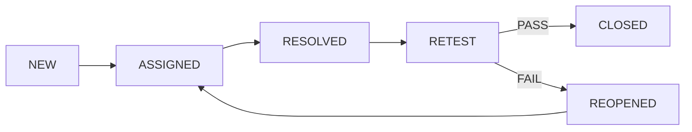

# Software Test Plan & RTM Specification — UII Event Management Platform

> **Universitas Islam Indonesia (UII)** — Badan Penjaminan Mutu Perangkat Lunak • Divisi Quality Assurance (QA)
> Software Quality Assurance (SQA) & Verification Framework
> Rencana Induk Pengujian Perangkat Lunak & Matriks Ketelusuran Kebutuhan (RTM)

**Komitmen Kualitas QA:** Dokumen ini menjadi pedoman operasional tunggal bagi QA Engineer untuk memastikan seluruh fungsi di Master PRD dan Kontrak API beroperasi tanpa celah cacat (*zero defects*). Pengujian mencakup validasi batas integritas Anti-Double Entry, uji beban Race Condition pada perebutan kuota terakhir, keandalan mesin pengingat WhatsApp Gateway, serta kecepatan Web Scanner QR Presensi di bawah 2 detik.

| Atribut | Nilai |
|---|---|
| Nomor Dokumen QA | DOC-STP-UII-EVT-2026-V1.0 (Master QA Release) |
| Tanggal Terbit | 17 November 2026 |
| Penyusun | Lead System Analyst (SA) & QA Lead |
| Standar Rekayasa | IEEE 829 Standard for Software Test Documentation / ISTQB Certified |
| Target Tim Pelaksana | QA Engineer, Backend Developer, Frontend Developer |
| Status Kelayakan Uji | READY FOR TEST EXECUTION |

## Riwayat Revisi Dokumen Pengujian

| Versi | Tanggal | Penyusun / Peran | Deskripsi Perubahan & Ruang Lingkup |
|---|---|---|---|
| v0.1 | 12 Nov 2026 | QA Engineer | Kerangka pengujian unit dan identifikasi endpoint API pendaftaran. |
| v0.8 | 15 Nov 2026 | Lead System Analyst | Draf awal Matriks Ketelusuran Kebutuhan (RTM) dari masalah ke test case. |
| v1.0 | 17 Nov 2026 | Lead SA & QA Lead | Master QA Plan: RTM lengkap 100%, 16 kasus uji kritis (Positif, Negatif, Edge Cases, Security), skrip uji beban k6, dan kriteria rilis. |

## Matriks Otorisasi Pengujian (Test Sign-off)

| Peran | Nama | Unit / Departemen | Status |
|---|---|---|---|
| Quality Assurance (QA) Lead | Rizky Pratama, S.Kom. | Divisi Pengujian & Penjaminan Mutu | APPROVED (17/11/2026) |
| Lead System Analyst | Fadhil Muhammad, S.Kom. | Engineering Architecture Lead | APPROVED (17/11/2026) |
| Backend Tech Lead | Ananda Dimas, S.Kom. | Backend & Database Architecture | APPROVED (17/11/2026) |

## Daftar Isi

1. [Rencana Induk Pengujian](#bab-1-rencana-induk-pengujian-master-test-plan-overview)
2. [Matriks Ketelusuran Kebutuhan (RTM)](#bab-2-matriks-ketelusuran-kebutuhan-lengkap-rtm)
3. [Desain Skenario Uji Terperinci](#bab-3-desain-skenario-uji-terperinci-detailed-test-cases)
4. [Pengujian Non-Fungsional (Performance & Security)](#bab-4-pengujian-kualitas-non-fungsional-performance--security)
5. [Manajemen Cacat & Kriteria Peluncuran](#bab-5-manajemen-cacat-perangkat-lunak--kriteria-peluncuran)

---

## BAB 1: Rencana Induk Pengujian (Master Test Plan Overview)

### 1.1 Sasaran Mutu & Ruang Lingkup Pengujian

Tujuan utama: membuktikan secara empiris bahwa sistem bebas dari kecacatan kritis yang dapat merusak operasional acara kampus.

**Critical Quality Objectives:**

- **Zero Double Entry:** 100% percobaan pendaftaran ganda dari NIM yang sama pada event yang sama wajib ditolak mulus (Error 409 Conflict).
- **Zero Over-Quota:** Tidak boleh ada race condition atau kuota minus saat kuota diperebutkan di detik terakhir.
- **Zero Fraudulent Attendance:** 100% tiket QR palsu atau yang sudah pernah di-scan wajib ditolak di meja registrasi.
- **100% Notification Delivery Assurance:** Seluruh peserta terdaftar wajib menerima pengingat (jika WhatsApp gagal, email kampus wajib terkirim).

### 1.2 Metodologi & Tingkat Pengujian (Test Pyramid)

| Tingkat Pengujian | Pelaksana & Alat | Fokus Verifikasi | Target Cakupan |
|---|---|---|---|
| **1. Unit Testing** | Backend Developer (Jest / PHPUnit / PyTest) | Logika hash HMAC QR Code, validasi format nomor WhatsApp, fungsi kalkulasi sisa kuota. | ≥ 85% Code Coverage |
| **2. API Integration Testing** | QA Engineer (Postman / Newman) | Kontrak request/response JSON, HTTP status code (200, 201, 400, 404, 409), rollback transaksi database. | 100% Endpoint Coverage |
| **3. End-to-End (E2E) UI Testing** | QA Engineer (Playwright / Cypress) | Alur lengkap: Katalog → Form pendaftaran → Lihat E-Tiket → Scan kamera → Unduh sertifikat. | 100% Critical User Paths |
| **4. Performance & Load Testing** | QA Engineer (k6 / Artillery) | Ketahanan transaksi database saat diserbu 250 transaksi pendaftaran konkuren di detik yang sama. | P95 Latency < 300 ms |
| **5. Security & Penetration Testing** | QA Engineer (OWASP ZAP / Burp Suite) | Pencegahan SQLi, XSS pada form custom questions, manipulasi token JWT. | Zero High/Critical Vulnerabilities |

### 1.3 Kriteria Memulai (Entry) & Mengakhiri (Exit)

**Entry Criteria:**

- Skema database DDL telah dimigrasikan ke server staging.
- Backend API lulus *Smoke Test* untuk endpoint dasar.
- Frontend terhubung dengan API staging atau mock server.
- Data uji (NIM mahasiswa, akun LEM, akun DPK) telah di-seed.

**Exit Criteria:**

- 100% skenario Prioritas P0 (Must-Have) berstatus PASS.
- Tidak ada bug aktif berstatus Blocker atau Critical.
- Waktu rata-rata scan QR presensi terbukti ≤ 2.0 detik.
- Laporan hasil uji formal ditandatangani oleh QA Lead dan SA.

### 1.4 Lingkungan Uji & Alat Kerja QA

| Komponen | Spesifikasi Teknis Staging | Tujuan & Peruntukan QA |
|---|---|---|
| Server Basis Data | PostgreSQL 15 pada Docker Container (Isolated Sandbox) | Menguji transaksi locking `SELECT FOR UPDATE` dan trigger constraint unik. |
| Mock Gateway WhatsApp | Mock API Server (WireMock / Prism) | Simulasi pengiriman sukses (200), nomor tidak terdaftar (400), dan server WA down (500). |
| Mock Meta Graph API | Meta Graph API Test User & App Sandbox | Verifikasi payload publikasi media tanpa memposting ke akun publik sungguhan. |
| Hardware Pemindai Barcode | Webcam Laptop 720p & Kamera Smartphone Android Chrome | Menguji keterbacaan QR Code dalam pencahayaan rendah dan layar ponsel peserta redup. |

### 1.5 Data Uji Standar (Master Test Data)

| Entitas | Kredensial / Identitas | Peran & Hak Akses | Peruntukan dalam Skenario |
|---|---|---|---|
| User Test 1 | NIM `21523001` • Ahmad Fikri | Mahasiswa (Informatika) | Pendaftaran pertama kali, penerbitan tiket, presensi Hadir. |
| User Test 2 | NIM `21523002` • Budi Santoso | Mahasiswa (Teknik Industri) | Batas kuota penuh (*Zero Quota*) dan masuk Waiting List. |
| User Test 3 | NIM `21523003` • Siti Rahma | Mahasiswa (Hukum) | Pembatalan tiket mandiri dan verifikasi pembatasan unduh sertifikat (Alpa). |
| Organizer 1 | `lem.fti@uii.ac.id` | Panitia Acara (LEM FTI) | Pembuatan draf event, upload poster, eksekusi Web Scanner meja registrasi. |
| Admin DPK | `dpk.admin@uii.ac.id` | Super Admin Kemahasiswaan | Kurasi, approval event, revisi, dan penolakan draf acara. |

---

## BAB 2: Matriks Ketelusuran Kebutuhan Lengkap (RTM)

RTM adalah bukti jaminan mutu bahwa 100% kebutuhan di PRD telah dipetakan ke komponen desain, antarmuka API, dan skenario uji QA.

| Kode FR | Kebutuhan Sistem (PRD) | Layar UI | Endpoint API Terkait | ID Kasus Uji | Prioritas |
|---|---|---|---|---|---|
| FR-EVT-01 | Katalog Terpusat & Filter | SCR-PUB-01 | `GET /api/v1/events` | TC-EVT-01 | P0 (MUST) |
| FR-EVT-02 | Monitoring Kuota Realtime | SCR-PUB-02 | `GET /api/v1/events/{id}` | TC-EVT-02 | P0 (MUST) |
| FR-EVT-03 | Auto-Post Instagram via API | SCR-ADM-01 | `PATCH /admin/events/{id}/review` | TC-SOC-01 | P2 (COULD) |
| FR-REG-01 | Auto-Fill Data Mahasiswa | SCR-REG-01 | `GET /api/v1/auth/me` | TC-REG-01 | P0 (MUST) |
| FR-REG-02 | Kunci Anti-Double Entry | SCR-REG-01 | `POST /events/{id}/register` | TC-REG-02 | P0 (MUST) |
| FR-REG-03 | Form Dinamis Oprec Panitia | SCR-REG-02 | `POST /events/{id}/apply-committee` | TC-OPR-01 | P1 (SHOULD) |
| FR-NOT-01 | Pengingat Otomatis H-1 WA | SCR-MHS-01 | `POST /cron/dispatch-reminders` | TC-NOT-01 | P1 (SHOULD) |
| FR-NOT-02 | Pengingat Kilat H-3 Jam | SCR-MHS-01 | `POST /cron/dispatch-reminders` | TC-NOT-02 | P1 (SHOULD) |
| FR-NOT-03 | Fallback Email Kampus SMTP | Backend Engine | Queue Worker (Fallback Job) | TC-NOT-03 | P1 (SHOULD) |
| FR-TCK-01 | Enkripsi HMAC QR E-Tiket | SCR-MHS-02 | `GET /me/tickets/{code}` | TC-TCK-01 | P0 (MUST) |
| FR-TCK-02 | Web Scanner Meja Registrasi | SCR-PAN-05 | `POST /attendance/scan` | TC-SCN-01 | P0 (MUST) |
| FR-TCK-03 | Deteksi Tiket Scan Duplikat | SCR-PAN-05 | `POST /attendance/scan` | TC-SCN-02 | P0 (MUST) |
| FR-TCK-04 | Pembatalan Tiket Mandiri | SCR-MHS-02 | `POST /me/tickets/{code}/cancel` | TC-TCK-02 | P2 (COULD) |
| FR-CRT-01 | Sertifikat Bersyarat Hadir | SCR-MHS-03 | `GET /me/certificates/{id}` | TC-CRT-01 | P1 (SHOULD) |
| FR-CRT-02 | Verifikasi Publik Hash SKPI | Portal Verifikasi | `GET /verify/{hash}` | TC-CRT-02 | P1 (SHOULD) |

> **Catatan konversi:** Di PDF, endpoint cron tertulis `/cron/dispatchreminders` (hyphen hilang saat ekstraksi); di sini ditulis `/cron/dispatch-reminders`. Cek lagi ke dokumen asli jika perlu persis.

---

## BAB 3: Desain Skenario Uji Terperinci (Detailed Test Cases)

### 3.1 Modul Pendaftaran & Kunci Anti-Double Entry

#### TC-REG-01: Pendaftaran Acara Sukses Pertama Kali (Happy Path) — `UJI POSITIF` • P0

**Prasyarat:** Akun mahasiswa 21523001 login aktif; acara "Seminar AI 2026" berstatus `PUBLISHED` dengan sisa kuota > 0.

**Langkah:**

1. Buka halaman detail acara `/events/seminar-nasional-ai-2026`.
2. Klik tombol "Daftar Peserta Sekarang" → arahkan ke form SCR-REG-01.
3. Verifikasi data NIM, Nama, dan Email terisi otomatis sesuai profil akun.
4. Input nomor WhatsApp aktif `081234567890` dan pilih ukuran kaos `L`.
5. Centang persetujuan tata tertib dan klik "Konfirmasi Pendaftaran".

**Data uji:**

```json
{"whatsapp_number": "081234567890", "custom_answers": {"tshirt_size": "L"}}
```

**Hasil yang diharapkan:** HTTP `201 Created`; halaman sukses SCR-REG-03 terbuka menampilkan kode tiket (contoh `TKT-UII-AI-891`); sisa kuota di database berkurang 1; record registrasi tersimpan berstatus `REGISTERED`.

#### TC-REG-02: Pencegahan Submisi Pendaftaran Ganda (Anti-Double Entry) — `UJI NEGATIF` • P0

**Prasyarat:** Akun 21523001 telah sukses mendaftar di "Seminar AI 2026" pada TC-REG-01.

**Langkah:**

1. Buka kembali URL pendaftaran event yang sama `/events/seminar-nasional-ai-2026/register`.
2. Amati kondisi antarmuka formulir.
3. Jika form masih terbuka, isi data dan paksa kirim request POST via cURL/Postman.

**Hasil yang diharapkan:**

- **UI:** Banner merah "Anda sudah terdaftar di acara ini!" dan tombol submit `disabled`.
- **API:** HTTP `409 Conflict` dengan error code `ERR_ALREADY_REGISTERED`.
- **Database:** Tidak ada baris pendaftaran baru (jumlah tiket tetap 1).

#### TC-REG-03: Concurrency Race Condition pada Perebutan Kuota Terakhir — `EDGE CASE TRANSAKSIONAL` • P0

**Prasyarat:** Acara "Workshop Robotika" diatur dengan sisa kuota tepat 1 kursi.

**Langkah:**

1. Siapkan 2 akun berbeda: User A (21523004) dan User B (21523005).
2. Gunakan skrip otomatis (k6 / Newman concurrent runner) untuk mengirim `POST /register` dari kedua user secara simultan di milidetik yang sama.

**Hasil yang diharapkan:** Tepat satu user memperoleh `201 Created` dan tiket; user kedua memperoleh `400 Bad Request` / `409` dengan pesan "Maaf, kuota acara baru saja habis!"; `quota_remaining` di database tepat `0` (tidak boleh `-1` atau bocor).

### 3.2 Presensi Meja Registrasi (Web Scanner Hari-H)

#### TC-SCN-01: Pemindaian Presensi QR Code Tiket Sah Pertama Kali — `UJI POSITIF` • P0

**Prasyarat:** Panitia membuka scanner SCR-PAN-05 di laptop meja registrasi; peserta 21523001 punya E-Tiket sah dengan `is_checked_in = FALSE`.

**Langkah:**

1. Peserta membuka layar HP menampilkan QR Code E-Tiket.
2. Panitia mengarahkan webcam laptop ke layar HP dari jarak 20–30 cm.
3. Amati respons visual dan audio pemindai.

**Hasil yang diharapkan:** Pemindai membaca barcode dalam **< 2 detik**; layar menampilkan kartu HIJAU "VALID: Ahmad Fikri - 21523001 - Presensi Tercatat!"; terdengar bip sukses; `is_checked_in` menjadi `TRUE` dan waktu presensi terisi di database.

#### TC-SCN-02: Deteksi & Penolakan Tiket yang Pernah Di-scan (Anti-Duplikasi) — `UJI NEGATIF` • P0

**Prasyarat:** Tiket 21523001 sudah sukses di-scan pada TC-SCN-01 (`is_checked_in = TRUE`).

**Langkah:**

1. Peserta kedua (atau teman yang menerima screenshot QR yang sama) mencoba masuk di pintu registrasi kedua.
2. Panitia mengarahkan scanner ke QR Code yang sama untuk kedua kalinya.

**Hasil yang diharapkan:** Scanner langsung mengeluarkan kartu MERAH berkedip; terdengar nada alarm; muncul teks "PERINGATAN! Tiket ini sudah pernah di-scan pada pukul 08:14 WIB!"; jumlah total kehadiran tidak bertambah.

#### TC-SCN-03: Penolakan Tiket Palsu dengan Hash Manipulasi (Security Tampering) — `UJI KEAMANAN` • P0

**Prasyarat:** Penguji membuat QR Code tiruan memakai generator barcode daring gratis dengan payload acak: `{"ticket": "PALSU-9999"}`.

**Langkah:** Arahkan scanner panitia ke QR Code tiruan tersebut.

**Hasil yang diharapkan:** Sistem memverifikasi tanda tangan HMAC-SHA256; server menolak dengan `404 Not Found` / `400 Invalid Signature`; layar scanner menampilkan status merah "Tiket Tidak Dikenali / Tidak Sah!".

### 3.3 Otomasi Pengingat & Integrasi Pihak Ketiga

#### TC-NOT-01: Eksekusi Pengingat WhatsApp H-1 Otomatis via Scheduler — `UJI POSITIF` • P1

**Prasyarat:** Acara "Seminar AI" mulai besok pukul 09.00 WIB; nomor HP penguji terdaftar sebagai peserta aktif; Mock WhatsApp Gateway aktif.

**Langkah:**

1. Picu background scheduler manual via terminal: `python manage.py run_reminders`.
2. Periksa antrean pengiriman di tabel `notification_logs`.
3. Periksa aplikasi WhatsApp di ponsel penguji.

**Hasil yang diharapkan:** Pesan WhatsApp masuk dalam **< 30 detik**; pesan memuat nama peserta, tanggal, ruangan gedung, dan tautan e-tiket; record di `notification_logs` berstatus `SENT` dan channel `WHATSAPP`.

#### TC-NOT-02: Pengalihan Otomatis ke Email Kampus (Fallback Mechanism) — `EDGE CASE & TOLERANSI GANGGUAN` • P1

**Prasyarat:** Mock WhatsApp Gateway dikonfigurasi mengembalikan HTTP `500 Service Unavailable` (simulasi server WA mati atau kuota habis).

**Langkah:** Picu eksekusi scheduler pengingat H-1.

**Hasil yang diharapkan:**

- Sistem mendeteksi kegagalan API WhatsApp dan mencatat status `FAILED` di log.
- Sistem otomatis mengaktifkan antrean fallback SMTP Email Kampus.
- Email pengingat berhasil masuk ke inbox `@students.uii.ac.id` mahasiswa.
- Tidak ada proses scheduler yang crash atau berhenti.

#### TC-SOC-01: Kurasi Admin Memublikasikan Poster ke Instagram via API — `UJI INTEGRASI` • P2

**Prasyarat:** Ada acara berstatus `PENDING_APPROVAL` di dashboard DPK; token Meta Graph API terkonfigurasi pada mode sandbox.

**Langkah:**

1. Login sebagai Super Admin DPK dan buka layar kurasi SCR-ADM-01.
2. Pilih draf acara, pastikan toggle "Auto-Post ke Instagram" aktif (ON).
3. Klik "Approve & Publish".

**Hasil yang diharapkan:** Status acara di katalog berubah `PUBLISHED`; sistem berhasil memanggil endpoint Meta `/media` dan `/media_publish`; ID posting Instagram terekam di database; muncul notifikasi sukses "Acara disetujui dan poster berhasil terbit di @uii.events!".

### 3.4 Brankas E-Sertifikat & Verifikasi SKPI

#### TC-CRT-01: Hak Unduh E-Sertifikat Terbuka Otomatis Pasca Presensi Hadir — `UJI POSITIF` • P1

**Prasyarat:** Mahasiswa 21523001 telah tervalidasi hadir pada TC-SCN-01 (status `ATTENDED`).

**Langkah:**

1. Login ke portal mahasiswa dan buka menu "Event Saya & Riwayat" (SCR-MHS-01).
2. Pilih tab "Riwayat Selesai & Sertifikat".
3. Amati status acara dan tombol unduh sertifikat.
4. Klik "Unduh E-Sertifikat (PDF)".

**Hasil yang diharapkan:** Acara berbadge hijau "Hadir"; tombol unduh aktif (hijau); PDF terunduh memuat nama lengkap mahasiswa, nomor seri resmi (contoh `UII/DPK/CERT/2026/0491`), dan QR link verifikasi.

#### TC-CRT-02: Penguncian Hak Unduh Sertifikat bagi Peserta Tidak Hadir — `UJI NEGATIF` • P1

**Prasyarat:** Mahasiswa 21523003 terdaftar tetapi **tidak pernah scan QR** pada hari-H hingga acara selesai (status `REGISTERED` / `ABSENT`).

**Langkah:** Buka tab Riwayat Selesai dan amati tombol sertifikat.

**Hasil yang diharapkan:** Badge abu-abu "Tidak Hadir"; tombol unduh `disabled`; tooltip "Sertifikat tidak diterbitkan karena Anda tidak hadir di lokasi acara."; request langsung ke URL endpoint unduh mengembalikan HTTP `403 Forbidden`.

#### TC-CRT-03: Verifikasi Publik Keaslian Sertifikat untuk SKPI — `UJI FUNGSIONAL` • P1

**Langkah:**

1. Scan QR Code verifikasi di sudut bawah lembar sertifikat PDF.
2. Peramban membuka tautan publik `https://uii-event.id/verify/{hash_signature}` tanpa login.

**Hasil yang diharapkan:** Halaman verifikasi publik menampilkan "SERTIFIKAT ASLI & TERVERIFIKASI"; menampilkan nama penerima, NIM, nama acara, tanggal pelaksanaan, dan legalitas ormawa penyelenggara yang diakui DPK UII.

---

## BAB 4: Pengujian Kualitas Non-Fungsional (Performance & Security)

### 4.1 Uji Beban & Lonjakan Transaksi Kuota (k6)

Untuk memvalidasi bahwa sistem tidak bocor kuota saat diserbu ratusan mahasiswa bersamaan, QA menyiapkan skrip uji beban k6:

```javascript
// tests/load/registration_concurrency.js
import http from 'k6/http';
import { check, sleep } from 'k6';

export const options = {
  scenarios: {
    quota_rush: {
      executor: 'per-vu-iterations',
      vus: 100,          // 100 Mahasiswa menembak bersamaan
      iterations: 1,
      maxDuration: '10s',
    },
  },
};

export default function () {
  const url = 'https://staging.uii-event.id/api/v1/events/evt-workshop-ai/register';

  const payload = JSON.stringify({
    whatsapp_number: `081234567${__VU.toString().padStart(3, '0')}`,
    custom_answers: { tshirt_size: 'L' }
  });

  const params = {
    headers: {
      'Content-Type': 'application/json',
      'Authorization': `Bearer ${__ENV[`TOKEN_USER_${__VU}`]}`,
    },
  };

  const res = http.post(url, payload, params);

  check(res, {
    'Status 201 Created ATAU 400 Quota Full': (r) => r.status === 201 || r.status === 400,
    'Latency di bawah 500ms': (r) => r.timings.duration < 500,
  });
}
```

**Benchmark Pass Criteria:** Jika kuota awal = 25 kursi, maka tepat **25** eksekusi wajib `201 Created` dan **75** lainnya wajib `400 Bad Request (Quota Full)`. Jika terbit 26 kursi, pengujian **FAILED (Kritis)** karena kebocoran kuota (*race condition*).

### 4.2 Pengujian Penetrasi Keamanan

| Vektor Serangan | Payload Uji | Hasil Evaluasi Pengamanan |
|---|---|---|
| **SQL Injection (SQLi)** | Input di search bar katalog: `' OR 1=1; DROP TABLE events; --` | **PASS:** Query diproses via ORM Parameterized Query; input diperlakukan sebagai teks biasa tanpa merusak struktur database. |
| **Cross-Site Scripting (XSS)** | Input di form custom question: `<script>alert('XSS')</script>` | **PASS:** Output disanitasi dan di-escape oleh React/Vue virtual DOM; skrip tidak dieksekusi di browser panitia. |
| **Insecure Direct Object Reference (IDOR)** | Mahasiswa A mengakses tiket Mahasiswa B via `GET /api/v1/me/tickets/TKT-USER-B` | **PASS:** Middleware otorisasi memvalidasi token JWT; sistem mengembalikan HTTP `403 Forbidden`. |

---

## BAB 5: Manajemen Cacat Perangkat Lunak & Kriteria Peluncuran

### 5.1 Matriks Tingkat Keparahan Cacat (Defect Severity Matrix)

| Tingkat Keparahan | Definisi | Contoh Kasus Nyata | Target Resolusi |
|---|---|---|---|
| **BLOCKER (S1)** | Sistem lumpuh total, server crash, data hilang, atau fitur pendaftaran mati total sehingga alur kerja berhenti. | Pendaftaran menghasilkan HTTP 500 terus-menerus; kamera scanner tidak bisa menyala sama sekali. | Segera, < 2 jam |
| **CRITICAL (S2)** | Fungsi bisnis utama gagal tanpa jalan keluar alternatif (*no workaround*). | Pencegahan double entry jebol (NIM sama bisa daftar 2×); kuota gedung bocor melebihi kapasitas. | Tuntas < 6 jam |
| **MAJOR (S3)** | Fungsi sekunder gagal, namun masih ada alternatif sementara. | Pesan WhatsApp reminder gagal terkirim (tetapi email fallback kampus berhasil masuk). | < 24 jam |
| **MINOR (S4)** | Masalah kosmetik, typo, atau ketidaksesuaian warna tombol. | Badge status "Tersedia" warnanya sedikit berbeda dari panduan Figma. | Sprint rilis berikutnya |

### 5.2 Siklus Hidup Cacat (Defect Lifecycle Workflow)



1. **NEW:** QA menemukan anomali dan mencatat laporan lengkap (langkah reproduksi, screenshot/video, log console).
2. **ASSIGNED:** Lead SA meninjau dan menugaskan bug ke Backend atau Frontend Developer terkait.
3. **RESOLVED:** Developer menyelesaikan perbaikan kode dan memperbarui environment staging.
4. **RETEST:** QA menjalankan kembali kasus uji terkait pada build terbaru.
5. **CLOSED:** Bug tuntas jika retest berstatus PASS. Jika masih gagal, status kembali ke **REOPENED**.

### 5.3 Kriteria Kelulusan Demo Magang (Release Sign-off Criteria)

**Go-Live Gate:** Prototipe UII Event Management dinyatakan **LULUS & SIAP DIDEMONSTRASIKAN** di hadapan dewan penguji magang jika memenuhi:

- ✅ 100% kasus uji Prioritas P0 (Must-Have) berstatus PASS.
- ✅ 0 (nol) cacat aktif berstatus Blocker atau Critical.
- ✅ Waktu presensi meja registrasi stabil di bawah 2 detik per peserta.
- ✅ Integritas data pendaftaran ganda (Anti-Double Entry) terbukti 100% kedap.

---
*© 2026 Tim Pengembang & Quality Assurance Perangkat Lunak UII — Klasifikasi: Dokumen Tata Kelola Kualitas Perangkat Lunak (SQA)*
