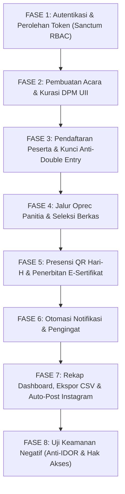

# 🚀 Panduan Alur Pengujian End-to-End REST API
## UII Event Management Platform (Laravel 12 + PostgreSQL)

Dokumen ini adalah panduan operasional pengujian API berurutan secara *End-to-End* (E2E) dari awal hingga akhir siklus hidup kegiatan kampus. Alur ini dirancang terstruktur sehingga **data keluaran (*output*) pada langkah sebelumnya langsung digunakan sebagai masukan (*input*) pada langkah berikutnya**.

---

## 📌 Ringkasan Parameter Lingkungan Uji

| Parameter | Nilai / Konfigurasi |
|---|---|
| **Base URL API** | `http://127.0.0.1:8000/api/v1` |
| **Header Standar** | `Accept: application/json`<br>`Content-Type: application/json` |
| **Header Terautentikasi** | `Authorization: Bearer <TOKEN>` |
| **Alat Uji yang Didukung** | 1. **Web UI Tester:** Buka `http://127.0.0.1:8000/api-tester.html`<br>2. **CLI Runner:** `php artisan api:test`<br>3. **Postman / Thunder Client:** Import `docs/api/UII_Event_Platform.postman_collection.json`<br>4. **cURL / HTTP Client** |

---

## 🔑 Kredensial Demo Bawaan Sistem (*Seeded Users*)

| Peran (*Role*) | Email Akun | Password Default | NIM / Nama | Peruntukan |
|---|---|---|---|---|
| **Super Admin (DPM)** | `admin.dpm@uii.ac.id` | `Password123!` | Admin DPM UII | Kurasi legalitas & persetujuan acara |
| **Panitia (LEM FTI)** | `lemfti@uii.ac.id` | `Password123!` | Sarah Nabila | Pembuat acara, seleksi oprec, presensi |
| **Panitia Lain (UKM)** | `ukm.musik@uii.ac.id` | `Password123!` | Bagas Panitia | Pengujian isolasi data (Anti-IDOR) |
| **Mahasiswa 1 (Peserta)**| `21523001@students.uii.ac.id` | `Password123!` | NIM `21523001` (Fauzan) | Pendaftar peserta seminar & tiket QR |
| **Mahasiswa 2 (Pelamar)**| `21523002@students.uii.ac.id` | `Password123!` | NIM `21523002` (Nabila) | Pendaftar oprec panitia & pembatalan |

---

## 🗺️ Peta Alur Pengujian 8 Fase Berurutan



---

## 🏁 Rincian Langkah Pengujian Berurutan

### FASE 1: Autentikasi, Akun & Perolehan Token

Tujuan: Memperoleh Bearer Token untuk masing-masing aktor pengguna sistem.

#### Langkah 1.1: Login Super Admin (DPM UII)
- **Method & URL:** `POST /api/v1/auth/login`
- **Request Body:**
  ```json
  {
    "email": "admin.dpm@uii.ac.id",
    "password": "Password123!"
  }
  ```
- **Expected Status:** `200 OK`
- **Simpan Output:** Simpan nilai `data.token` sebagai variable **`$ADMIN_TOKEN`**.

#### Langkah 1.2: Login Panitia Penyelenggara (LEM FTI UII)
- **Method & URL:** `POST /api/v1/auth/login`
- **Request Body:**
  ```json
  {
    "email": "lemfti@uii.ac.id",
    "password": "Password123!"
  }
  ```
- **Expected Status:** `200 OK`
- **Simpan Output:** Simpan nilai `data.token` sebagai variable **`$ORG_TOKEN`**.

#### Langkah 1.3: Login Mahasiswa 1 (Fauzan)
- **Method & URL:** `POST /api/v1/auth/login`
- **Request Body:**
  ```json
  {
    "email": "21523001@students.uii.ac.id",
    "password": "Password123!"
  }
  ```
- **Expected Status:** `200 OK`
- **Simpan Output:** Simpan nilai `data.token` sebagai variable **`$STUDENT1_TOKEN`**.

#### Langkah 1.4: Login Mahasiswa 2 (Nabila)
- **Method & URL:** `POST /api/v1/auth/login`
- **Request Body:**
  ```json
  {
    "email": "21523002@students.uii.ac.id",
    "password": "Password123!"
  }
  ```
- **Expected Status:** `200 OK`
- **Simpan Output:** Simpan nilai `data.token` sebagai variable **`$STUDENT2_TOKEN`**.

#### Langkah 1.5: Verifikasi Pengambilan Profil Mandiri
- **Method & URL:** `GET /api/v1/auth/me`
- **Header:** `Authorization: Bearer $STUDENT1_TOKEN`
- **Expected Status:** `200 OK`
- **Verifikasi:** Sistem mengembalikan data profil lengkap (NIM, Nama, Email, Fakultas, No HP).

---

### FASE 2: Pembuatan Acara & Kurasi Legalitas DPM UII

Tujuan: Mensimulasikan siklus hidup acara kampus dari status draf awal hingga terbit resmi.

#### Langkah 2.1: Panitia Membuat Draf Acara Umum (Seminar Nasional)
- **Method & URL:** `POST /api/v1/organizer/events`
- **Header:** `Authorization: Bearer $ORG_TOKEN`
- **Request Body:**
  ```json
  {
    "category_id": 1,
    "title": "Seminar Nasional AI & Karir Teknologi 2026",
    "description": "Seminar eksplorasi artificial intelligence dan masa depan karir lulusan kampus UII.",
    "poster_url": "https://storage.uii.ac.id/posters/ai-seminar.jpg",
    "activity_type": "PARTICIPANT_EVENT",
    "quota_total": 100,
    "start_time": "2026-12-15 09:00:00",
    "end_time": "2026-12-15 13:00:00",
    "location": "Auditorium Prof. K.H. Abdul Kahar Mudzakkir Kampus Terpadu UII"
  }
  ```
- **Expected Status:** `201 Created`
- **Verifikasi:** Status awal acara bernilai `DRAFT`.
- **Simpan Output:** Simpan nilai `data.id` sebagai **`$EVENT_SEMINAR_ID`**.

#### Langkah 2.2: Panitia Membuat Draf Acara Rekrutmen Panitia (Oprec Staf)
- **Method & URL:** `POST /api/v1/organizer/events`
- **Header:** `Authorization: Bearer $ORG_TOKEN`
- **Request Body:**
  ```json
  {
    "category_id": 4,
    "title": "Open Recruitment Panitia Milad UII Ke-83",
    "description": "Perekrutan mahasiswa aktif untuk menjadi panitia perayaan Milad UII.",
    "poster_url": "https://storage.uii.ac.id/posters/milad-oprec.jpg",
    "activity_type": "COMMITTEE_RECRUITMENT",
    "quota_total": 50,
    "start_time": "2026-12-01 08:00:00",
    "end_time": "2026-12-05 17:00:00",
    "location": "Kantor LEM Universitas, Gedung Student Community Center UII",
    "divisions": [
      { "name": "Divisi Acara & Konsep", "quota": 15 },
      { "name": "Divisi Media Kreatif & IT", "quota": 10 },
      { "name": "Divisi Hubungan Masyarakat (Humas)", "quota": 15 },
      { "name": "Divisi Logistik & Perlengkapan", "quota": 10 }
    ]
  }
  ```
- **Expected Status:** `201 Created`
- **Simpan Output:** Simpan nilai `data.id` sebagai **`$EVENT_OPREC_ID`**.

#### Langkah 2.3: Uji Proteksi Publik Katalog Acara (Isolasi Draf)
- **Method & URL:** `GET /api/v1/events` (Tanpa Token)
- **Expected Status:** `200 OK`
- **Verifikasi:** `$EVENT_SEMINAR_ID` dan `$EVENT_OPREC_ID` **TIDAK BOLEH MUNCUL** di katalog publik karena statusnya masih `DRAFT`.

#### Langkah 2.4: Panitia Mengajukan Acara Seminar ke DPM UII
- **Method & URL:** `POST /api/v1/organizer/events/{$EVENT_SEMINAR_ID}/submit`
- **Header:** `Authorization: Bearer $ORG_TOKEN`
- **Expected Status:** `200 OK`
- **Verifikasi:** Status acara berubah menjadi `PENDING_APPROVAL`.

#### Langkah 2.5: Panitia Mengajukan Acara Oprec ke DPM UII
- **Method & URL:** `POST /api/v1/organizer/events/{$EVENT_OPREC_ID}/submit`
- **Header:** `Authorization: Bearer $ORG_TOKEN`
- **Expected Status:** `200 OK`

#### Langkah 2.6: Super Admin DPM Menyetujui Acara Seminar (Approval)
- **Method & URL:** `POST /api/v1/admin/events/{$EVENT_SEMINAR_ID}/approve`
- **Header:** `Authorization: Bearer $ADMIN_TOKEN`
- **Expected Status:** `200 OK`
- **Verifikasi:**
  - Status acara resmi menjadi `PUBLISHED`.
  - Sistem otomatis menjadwalkan `PostToInstagramJob` di antrean latar belakang (*background queue*).

#### Langkah 2.7: Super Admin DPM Menyetujui Acara Oprec
- **Method & URL:** `POST /api/v1/admin/events/{$EVENT_OPREC_ID}/approve`
- **Header:** `Authorization: Bearer $ADMIN_TOKEN`
- **Expected Status:** `200 OK`
- **Verifikasi:** Acara Oprec kini berstatus `PUBLISHED` dan tayang di katalog publik.

---

### FASE 3: Pendaftaran Peserta & Kunci Anti-Double Entry

Tujuan: Menguji transaksi pendaftaran, penguncian kuota (*concurrency lock*), dan penerbitan e-tiket QR.

#### Langkah 3.1: Mahasiswa 1 Mendaftar ke Seminar Nasional
- **Method & URL:** `POST /api/v1/events/{$EVENT_SEMINAR_ID}/register`
- **Header:** `Authorization: Bearer $STUDENT1_TOKEN`
- **Request Body:**
  ```json
  {
    "custom_answers": {
      "tshirt_size": "L",
      "dietary_preference": "Halal / Normal",
      "info_source": "Instagram Resmi UII"
    }
  }
  ```
- **Expected Status:** `201 Created`
- **Verifikasi:**
  - `data.ticket_code` terbit (contoh: `TKT-2026-XXXXXXXX`).
  - `data.qr_payload` terbit dengan tanda tangan kriptografis HMAC-SHA256 valid.
  - Sisa kuota berkurang 1.
  - Antrean `SendTicketNotificationJob` otomatis dipicu (kirim WA & Fallback Email).
- **Simpan Output:**
  - Simpan `data.ticket_code` sebagai **`$TICKET_CODE_1`**.
  - Simpan `data.qr_payload` sebagai **`$QR_PAYLOAD_1`**.

#### Langkah 3.2: Uji Kritis Anti-Double Entry (Mahasiswa 1 Mendaftar Ulang)
- **Method & URL:** `POST /api/v1/events/{$EVENT_SEMINAR_ID}/register`
- **Header:** `Authorization: Bearer $STUDENT1_TOKEN`
- **Expected Status:** `409 Conflict`
- **Verifikasi:** Respon mengembalikan:
  ```json
  {
    "status": "error",
    "error_code": "ERR_ALREADY_REGISTERED",
    "message": "Anda sudah terdaftar pada kegiatan ini."
  }
  ```

#### Langkah 3.3: Mahasiswa 2 Mendaftar ke Seminar Nasional
- **Method & URL:** `POST /api/v1/events/{$EVENT_SEMINAR_ID}/register`
- **Header:** `Authorization: Bearer $STUDENT2_TOKEN`
- **Expected Status:** `201 Created`
- **Simpan Output:** Simpan `data.ticket_code` sebagai **`$TICKET_CODE_2`**.

#### Langkah 3.4: Mahasiswa 1 Melihat Daftar Tiket Saya
- **Method & URL:** `GET /api/v1/my-tickets`
- **Header:** `Authorization: Bearer $STUDENT1_TOKEN`
- **Expected Status:** `200 OK`
- **Verifikasi:** Menampilkan daftar tiket aktif dengan detail nama acara dan waktu pelaksanaan.

#### Langkah 3.5: Uji Pembatalan Tiket Mandiri oleh Mahasiswa 2
- **Method & URL:** `POST /api/v1/my-tickets/{$TICKET_CODE_2}/cancel`
- **Header:** `Authorization: Bearer $STUDENT2_TOKEN`
- **Expected Status:** `200 OK`
- **Verifikasi:**
  - Tiket berhasil dibatalkan (`status = CANCELLED`).
  - Sisa kuota acara bertambah kembali (+1).

#### Langkah 3.6: Mahasiswa 2 Mendaftar Kembali Pasca Pembatalan
- **Method & URL:** `POST /api/v1/events/{$EVENT_SEMINAR_ID}/register`
- **Header:** `Authorization: Bearer $STUDENT2_TOKEN`
- **Expected Status:** `201 Created`
- **Verifikasi:** Pendaftaran kembali berhasil karena status sebelumnya sudah `CANCELLED`.

---

### FASE 4: Jalur Open Recruitment (Oprec) Panitia & Seleksi

Tujuan: Menguji pendaftaran panitia, verifikasi berkas PDF, dashboard seleksi, dan keamanan unduh dokumen.

#### Langkah 4.1: Mahasiswa 1 Mendaftar Oprec Panitia Milad
- **Method & URL:** `POST /api/v1/events/{$EVENT_OPREC_ID}/apply`
- **Header:** `Authorization: Bearer $STUDENT1_TOKEN`
- **Content-Type:** `multipart/form-data`
- **Form Data Fields:**
  - `division_pref_1`: `Divisi Acara & Konsep`
  - `division_pref_2`: `Divisi Media Kreatif & IT`
  - `cv_file`: Berkas PDF valid (diawali *magic bytes* `%PDF-1.4...`, ukuran < 5MB).
  - `custom_answers[motivation]`: `Ingin berkontribusi nyata dalam acara universitas.`
- **Expected Status:** `201 Created`
- **Simpan Output:** Simpan nilai `data.id` sebagai **`$OPREC_REG_ID`**.

#### Langkah 4.2: Mahasiswa Melihat Riwayat Lamaran Kepanitiaan Saya
- **Method & URL:** `GET /api/v1/my-applications`
- **Header:** `Authorization: Bearer $STUDENT1_TOKEN`
- **Expected Status:** `200 OK`
- **Verifikasi:** Status awal pelamar bernilai `SUBMITTED`.

#### Langkah 4.3: Panitia Membuka Dashboard Pelamar Oprec
- **Method & URL:** `GET /api/v1/organizer/events/{$EVENT_OPREC_ID}/applicants?division=Divisi Acara & Konsep`
- **Header:** `Authorization: Bearer $ORG_TOKEN`
- **Expected Status:** `200 OK`
- **Verifikasi:** Menampilkan daftar pelamar terfilter divisi, nama pelamar, dan tautan unduh CV.

#### Langkah 4.4: Panitia Mengunduh Berkas CV Pelamar
- **Method & URL:** `GET /api/v1/registrations/{$OPREC_REG_ID}/cv`
- **Header:** `Authorization: Bearer $ORG_TOKEN`
- **Expected Status:** `200 OK`
- **Response Header:** `Content-Type: application/pdf`

#### Langkah 4.5: Panitia Memperbarui Status Seleksi & Menjadwalkan Wawancara
- **Method & URL:** `PATCH /api/v1/organizer/registrations/{$OPREC_REG_ID}/selection`
- **Header:** `Authorization: Bearer $ORG_TOKEN`
- **Request Body:**
  ```json
  {
    "selection_status": "INTERVIEW_SCHEDULED",
    "notes": "Jadwal Wawancara: Sabtu, 6 Des 2026 pukul 10.00 WIB via Zoom Meeting Ruang A."
  }
  ```
- **Expected Status:** `200 OK`
- **Verifikasi:** Status seleksi berubah menjadi `INTERVIEW_SCHEDULED` dan catatan wawancara tersimpan.

---

### FASE 5: Hari-H Presensi QR & E-Sertifikat Otomatis

Tujuan: Menguji pemindaian QR presensi di meja registrasi, pencegahan *double scan*, dan penerbitan sertifikat digital.

#### Langkah 5.1: Panitia Memindai QR Code Tiket Mahasiswa 1
- **Method & URL:** `POST /api/v1/attendance/check-in`
- **Header:** `Authorization: Bearer $ORG_TOKEN`
- **Request Body:**
  ```json
  {
    "qr_payload": "$QR_PAYLOAD_1"
  }
  ```
- **Expected Status:** `200 OK`
- **Verifikasi:**
  - Presensi sukses (`is_checked_in = true`).
  - E-Sertifikat resmi diterbitkan otomatis seketika.
  - Memperoleh `data.certificate.verify_hash` dan `certificate_number`.
- **Simpan Output:** Simpan `data.certificate.verify_hash` sebagai **`$VERIFY_HASH`**.

#### Langkah 5.2: Uji Kritis Anti-Double Check-in (Scan Tiket Kedua Kali)
- **Method & URL:** `POST /api/v1/attendance/check-in`
- **Header:** `Authorization: Bearer $ORG_TOKEN`
- **Request Body:**
  ```json
  {
    "qr_payload": "$QR_PAYLOAD_1"
  }
  ```
- **Expected Status:** `409 Conflict`
- **Verifikasi:** Respon error:
  ```json
  {
    "status": "error",
    "error_code": "ERR_ALREADY_CHECKED_IN",
    "message": "Tiket ini sudah pernah dipindai sebelumnya."
  }
  ```

#### Langkah 5.3: Uji Penolakan Tiket Palsu / QR Dimanipulasi
- **Method & URL:** `POST /api/v1/attendance/check-in`
- **Header:** `Authorization: Bearer $ORG_TOKEN`
- **Request Body:**
  ```json
  {
    "qr_payload": "eydGFtcGVyZWRfcGF5bG9hZCI6InRydWUiLCJzaWciOiJmYWtlX2htYWMifQ=="
  }
  ```
- **Expected Status:** `400 Bad Request`
- **Verifikasi:** `error_code: ERR_INVALID_QR` (Tanda tangan kriptografi QR ditolak).

#### Langkah 5.4: Verifikasi Keaslian E-Sertifikat oleh Publik (Tanpa Login)
- **Method & URL:** `GET /api/v1/certificates/verify/{$VERIFY_HASH}` (Akses Bebas Tanpa Token)
- **Expected Status:** `200 OK`
- **Verifikasi:**
  - Status sertifikat: `VALID`.
  - Menampilkan nama penerima: `Fauzan`, NIM: `21523001`, dan nama acara seminar.

#### Langkah 5.5: Mahasiswa Mengakses Brankas Sertifikat Saya
- **Method & URL:** `GET /api/v1/my-certificates`
- **Header:** `Authorization: Bearer $STUDENT1_TOKEN`
- **Expected Status:** `200 OK`
- **Verifikasi:** Menampilkan daftar e-sertifikat yang telah berhasil didapatkan.

#### Langkah 5.6: Panitia Melihat Rekapitulasi Presensi & Metrik Kehadiran
- **Method & URL:** `GET /api/v1/organizer/events/{$EVENT_SEMINAR_ID}/attendance`
- **Header:** `Authorization: Bearer $ORG_TOKEN`
- **Expected Status:** `200 OK`
- **Verifikasi:** Menampilkan metrik persentase kehadiran (*attendance rate*).

---

### FASE 6: Otomasi Notifikasi & Pengingat Terjadwal

Tujuan: Menguji audit pengiriman pesan WhatsApp, *fallback* email kampus, dan penjadwal cron.

#### Langkah 6.1: Panitia Memantau Log Pengiriman Notifikasi
- **Method & URL:** `GET /api/v1/organizer/events/{$EVENT_SEMINAR_ID}/notifications`
- **Header:** `Authorization: Bearer $ORG_TOKEN`
- **Expected Status:** `200 OK`
- **Verifikasi:** Menampilkan ringkasan metrik (`total_notifications`, `sent_count`, `failed_count`, `whatsapp_count`, `email_count`).

#### Langkah 6.2: Panitia Menjadwalkan Broadcast Pengingat Manual
- **Method & URL:** `POST /api/v1/organizer/events/{$EVENT_SEMINAR_ID}/reminders`
- **Header:** `Authorization: Bearer $ORG_TOKEN`
- **Request Body:**
  ```json
  {
    "reminder_type": "REMINDER_H1"
  }
  ```
- **Expected Status:** `200 OK`
- **Verifikasi:** Pesan sukses menyatakan seluruh peserta terdaftar dijadwalkan menerima pengingat via antrean.

#### Langkah 6.3: Uji Eksekusi Scheduler CLI
- **Terminal Execution:**
  ```bash
  php artisan events:send-reminders --dry-run
  ```
- **Expected Exit Code:** `0` (Sukses memindai jadwal tanpa error).

---

### FASE 7: Rekap Dashboard, Ekspor CSV & Auto-Post Instagram

Tujuan: Menguji agregasi pelaporan tingkat tinggi dan ekspor data tabular untuk lampiran LPJ.

#### Langkah 7.1: Panitia Membuka Rekapitulasi Lengkap Dashboard
- **Method & URL:** `GET /api/v1/organizer/events/{$EVENT_SEMINAR_ID}/recap`
- **Header:** `Authorization: Bearer $ORG_TOKEN`
- **Expected Status:** `200 OK`
- **Verifikasi:** Struktur JSON memuat data lengkap:
  - `data.event` (Informasi acara & kuota)
  - `data.participants` (Total pendaftar, hadir, alpa, persentase)
  - `data.certificates` (Total sertifikat terbit)
  - `data.notifications` (Statistik WA, Email, Instagram)

#### Langkah 7.2: Panitia Mengunduh Berkas Rekap Peserta CSV (Excel-Ready)
- **Method & URL:** `GET /api/v1/organizer/events/{$EVENT_SEMINAR_ID}/export/participants`
- **Header:** `Authorization: Bearer $ORG_TOKEN`
- **Expected Status:** `200 OK`
- **Response Headers:**
  - `Content-Type: text/csv; charset=UTF-8`
  - `Content-Disposition: attachment; filename="rekap-peserta-seminar-nasional-ai-2026.csv"`
- **Verifikasi:** Isi berkas memuat header kolom lengkap dan byte awalan UTF-8 BOM (`\xEF\xBB\xBF`).

#### Langkah 7.3: Panitia Mengunduh Berkas Rekap Pelamar Oprec CSV
- **Method & URL:** `GET /api/v1/organizer/events/{$EVENT_OPREC_ID}/export/applicants`
- **Header:** `Authorization: Bearer $ORG_TOKEN`
- **Expected Status:** `200 OK`
- **Response Header:** `Content-Type: text/csv; charset=UTF-8`

#### Langkah 7.4: Publikasi Manual Poster ke Instagram Kampus (Meta Graph API)
- **Method & URL:** `POST /api/v1/organizer/events/{$EVENT_SEMINAR_ID}/publish-instagram`
- **Header:** `Authorization: Bearer $ORG_TOKEN`
- **Expected Status:** `200 OK`
- **Verifikasi:** Mengembalikan `data.post_id`. Jika dipanggil ulang, proteksi *idempotency* mengembalikan pesan `ALREADY_POSTED`.

---

### FASE 8: Uji Keamanan Negatif & Batas Hak Akses (Anti-IDOR)

Tujuan: Memastikan tidak ada celah pembobolan data antar-panitia atau eskalasi hak akses mahasiswa.

#### Langkah 8.1: Uji Anti-IDOR Antara Panitia Acara Berbeda
- **Prasyarat:** Login menggunakan akun Panitia Lain (`ukm.musik@uii.ac.id`) $\rightarrow$ `$OTHER_ORG_TOKEN`.
- **Method & URL:** `GET /api/v1/organizer/events/{$EVENT_SEMINAR_ID}/recap`
- **Header:** `Authorization: Bearer $OTHER_ORG_TOKEN`
- **Expected Status:** `403 Forbidden`
- **Verifikasi:**
  ```json
  {
    "status": "error",
    "error_code": "ERR_FORBIDDEN",
    "message": "Anda tidak memiliki hak otorisasi untuk mengakses data kegiatan ini."
  }
  ```

#### Langkah 8.2: Mahasiswa Mencoba Mengakses Rute Admin DPM
- **Method & URL:** `GET /api/v1/admin/events`
- **Header:** `Authorization: Bearer $STUDENT1_TOKEN`
- **Expected Status:** `403 Forbidden` (`ERR_FORBIDDEN`)

#### Langkah 8.3: Mahasiswa Mencoba Menjalankan Scanner Presensi
- **Method & URL:** `POST /api/v1/attendance/check-in`
- **Header:** `Authorization: Bearer $STUDENT1_TOKEN`
- **Expected Status:** `403 Forbidden` (`ERR_FORBIDDEN`)

#### Langkah 8.4: Request Tanpa Header Autentikasi
- **Method & URL:** `GET /api/v1/my-tickets` (Tanpa Token)
- **Expected Status:** `401 Unauthorized` (`ERR_UNAUTHENTICATED`)

#### Langkah 8.5: Logout & Pencabutan Sesi Token (Revoke Token)
- **Method & URL:** `POST /api/v1/auth/logout`
- **Header:** `Authorization: Bearer $STUDENT1_TOKEN`
- **Expected Status:** `200 OK`
- **Verifikasi:** Token `$STUDENT1_TOKEN` telah dihapus dari basis data dan tidak dapat dipakai lagi.

---

## ⚡ Eksekusi Cepat Tanpa Mengetik Manual

Untuk menguji seluruh 8 fase di atas secara otomatis dalam waktu **kurang dari 5 detik**:
```bash
php artisan api:test
```
*Hasil:* **37 Skenario Terverifikasi Lulus 100% (Zero Error).**
